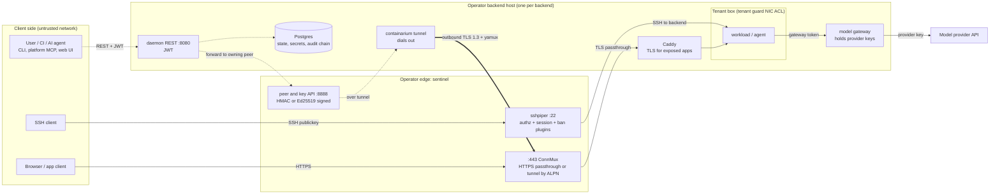
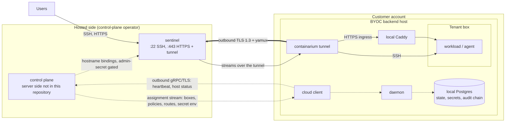
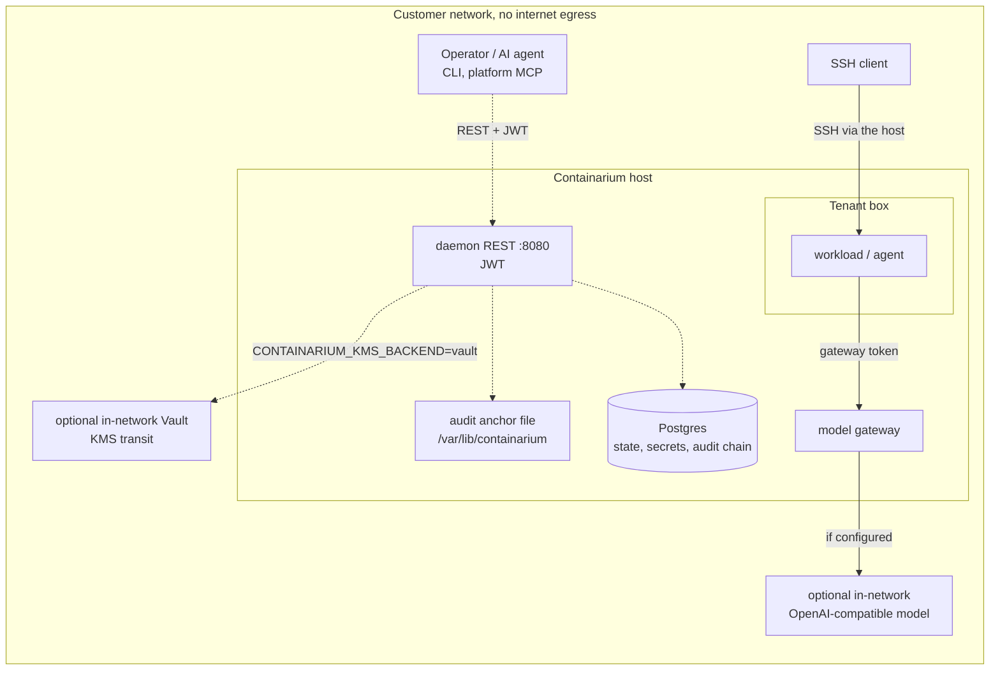

# Deployment modes: hosted, BYOC, on-prem / air-gapped

> Status: **Implemented** (describes the daemon, sentinel and `internal/cloud/` client in this repository; any linked page marked "draft design" is not implemented).

This page shows the three ways the open-source code can be deployed. For each
mode it shows the trust boundaries, the control-plane and data-plane traffic,
and what crosses the network. It describes only what the code in this
repository does. The hosted control plane's server side is **not** in this
repository; this repository contains only its client (`internal/cloud/`) and the
sentinel endpoints it calls. Where a page below is a draft design, it says so.

Related: where each kind of customer data is stored and for how long is in
[DATA-FLOW-AND-RETENTION.md](../security/DATA-FLOW-AND-RETENTION.md).

Part of #2557.

## Components

| Component | What it is | Source |
|---|---|---|
| Daemon | `containariumd daemon`. REST on `--http-port` (default 8080, JWT). gRPC on `--port` (default 50051) is served externally **only with `--mtls`**. Without it there is no external gRPC listener, and the REST gateway uses an in-process one. | `internal/cmd/daemon.go`, `internal/server/dual_server.go` |
| Core service LXCs | Postgres (daemon state, routes, secrets, audit hash chain), Caddy (app ingress), and optionally security, OTel and VictoriaMetrics. They run on the same host as the daemon. | `pkg/core/incus/client.go`, `docs/BYOC-BACKEND-BRINGUP.md` |
| Boxes | Tenant Incus containers, or pods on the K8s runtime (`--runtime k8s`). | `pkg/core/box/`, `docs/K8S-AGENT-BOX-RUNTIME-DESIGN.md` |
| Model gateway | Built into the daemon when a provider is configured, or run standalone as `model-gateway serve`. Boxes present short-lived gateway tokens. The provider key stays in the gateway. | `cmd/model-gateway/README.md`, `internal/modelgateway/` |
| Sentinel | `containariumd sentinel`. SSH front door on :22 (sshpiper with authz, session and ban plugins). HTTPS on :443, forwarded to the backend's Caddy without terminating TLS, with tunnel sessions told apart by ALPN `containarium-tunnel/1`. Peer and key API on :8888. | `internal/cmd/sentinel.go`, `internal/sentinel/`, `docs/SENTINEL-DESIGN.md` |
| Tunnel | `containarium tunnel`. The backend dials **out** to the sentinel's :443 over TLS 1.3 and runs yamux inside. The sentinel then opens streams back to the backend's local ports. | `internal/sentinel/tunnel_client.go`, `docs/TUNNEL-REVERSE-PROXY.md` |
| Cloud client | `containarium cloud enroll`. Outbound gRPC/TLS from the daemon to a control plane: heartbeat, host status, an assignment stream, and a daemon-minted driver token. | `internal/cloud/` |
| MCP servers | `cmd/mcp-server` (platform; REST + JWT) and `cmd/agent-box` (in-box; stdio over SSH). | `cmd/mcp-server/`, `cmd/agent-box/` |

**Control plane** means calls that change platform state: create, list, expose,
route, secrets, policy. **Data plane** means traffic to and from what tenants
run: SSH sessions, HTTP(S) to exposed ports, model calls, and box egress. In
the diagrams, dotted arrows are control plane, solid arrows are data plane,
and each box with a title is a trust boundary.

## Hosted (SaaS)

The operator runs the sentinel and the backends. Each backend runs its own
daemon, Postgres and Caddy. A backend behind a firewall joins through the
outbound tunnel. A primary daemon forwards calls for a box it does not hold to
the peer that owns it, through the sentinel's peer proxy.

What crosses the network: SSH sessions and HTTPS to the sentinel; the
backend's outbound tunnel; REST calls to the daemon; model calls from the
gateway to the provider. The sentinel does not terminate tenant TLS on this
path, so Caddy on the backend holds the certificate. With the tunnel, the
sentinel reaches the backend's SSH and API only through loopback-bound
listeners on the sentinel (`docs/MULTI-BACKEND-PEERS.md`).

## BYOC (bring your own cloud)

The backend runs in the customer's account. It has its own daemon and its own
Postgres, so its state, secrets and audit chain stay in that Postgres. It joins
a control plane run elsewhere, over two **outbound** connections: the tunnel
to the sentinel, and the cloud client to the control plane. Nothing in this
code needs an inbound port on the BYOC host.

What crosses the boundary into the customer account: the assignment stream,
which carries desired boxes, per-org network policies, routes and secret
environment values (`internal/cloud/client.go`); and user SSH and HTTPS,
carried over the tunnel. What leaves it: heartbeat and host status (CPU, RAM,
disk and GPU totals, and capability checks), the driver token, and tunnel
traffic. Sentinel SSH session records can be shipped to the backend's own
audit store (`internal/sentinel/ssh_session_shipper.go`; the design,
`sentinel-ssh-session-audit-ingest.md`, is marked proposed).

Where public TLS ends for a BYOC host is not settled.
`docs/BYOC-BACKEND-BRINGUP.md` describes the sentinel terminating TLS and
forwarding plaintext over the tunnel to `CONTAINARIUM_BYOC_INGRESS_ADDR`.
`docs/BYOC-PUBLIC-INGRESS-DESIGN.md` (draft) chooses SNI passthrough to the
host's Caddy. Code exists for the first (`internal/config/byoc.go`).

## On-prem / air-gapped

One host is installed from the offline bundle (`hacks/offline-install/`). The
installer makes no network calls. It installs no sentinel, tunnel or cloud
enrollment, and its service unit runs the daemon with `--rest` and no
`--mtls`. A default install therefore exposes REST on :8080 only.

Every outbound dependency is opt-in, and each is off unless configured:

- model providers (an in-network OpenAI-compatible upstream can be registered instead);
- Caddy ACME for public certificates;
- `CONTAINARIUM_AUDIT_ANCHOR_BUCKET` (without it, anchors go to the local file only);
- `CONTAINARIUM_AUDIT_ANCHOR_TSA_URL`, an RFC 3161 timestamp authority (it can point inside the network; without it, no anchor is stamped);
- a cloud KMS (`CONTAINARIUM_KMS_BACKEND` is `none` by default; `vault` can point inside the network);
- the cloud client.

Managed backups need the `gcp` KMS backend (`internal/server/backup_server.go`),
so they are not available air-gapped.

## Trust boundaries the code enforces

| Boundary | How it is authenticated | Source |
|---|---|---|
| Client → daemon REST | JWT bearer (HS256, secret of at least 32 bytes), or a session cookie set through `POST /v1/auth/session` | `internal/auth/middleware.go`, `internal/auth/token.go` |
| Client → daemon gRPC | Mutual TLS, only with `--mtls`; identity comes from the client certificate | `internal/server/dual_server.go`, `internal/mtls/` |
| Daemon ↔ sentinel | Shared HMAC secret or Ed25519 key; a separate admin secret gates tunnel-token registration and BYOC route pushes | `internal/server/peer.go`, `internal/sentinel/byoc_route_handler.go` |
| Backend → sentinel tunnel | TLS 1.3, a token bound to the session, a pinned sentinel identity; cleartext tunnels are refused | `internal/sentinel/tunnel_client.go`, `docs/TUNNEL-REVERSE-PROXY.md` |
| User → box over SSH | Public key only, checked per connection by the authz plugin (audit-only or enforce) | `docs/SENTINEL-SSH-AUTHZ.md` |
| Box ↔ box, box → core services | Tenant guard and core-infra guard, Incus NIC ACLs, on by default | `internal/tenantguard/`, `internal/coreguard/`, `docs/architecture/tenant-network-guard.md` |
| Box → model provider | The box holds only a short-lived gateway token; the gateway adds the provider key | `cmd/model-gateway/README.md` |
| Secrets at rest | AES-256-GCM under a master key, or per-row DEKs wrapped by a KMS key | `internal/secrets/store.go`, `docs/security/KMS-ENVELOPE-DESIGN.md` |

## Host prerequisites

These come from the installers and `internal/hostcheck`. **Enforced** means
the installer exits, or `containarium doctor` reports a failed required check
and exits non-zero (`containarium pool join` refuses to continue on one).
**Warned** means a log line or an advisory posture item. **Installed** means
the installer sets it up. Run `containarium doctor` on the host to check the
enforced and warned items.

| Area | Requirement | Kind | Source |
|---|---|---|---|
| OS | `/etc/os-release` present | Enforced | `hacks/install.sh` `check_os`, `hacks/offline-install/install.sh` |
| OS | Ubuntu 24.04 or 22.04; any other distro or version gets a warning and the install continues | Warned | `hacks/install.sh` `check_os` |
| OS | systemd 254 or later for the unit's restart back-off; older versions only lose that behaviour | Not checked | `internal/cmd/service.go` |
| Architecture | amd64 or arm64 for the server; the CLI installer has no linux-arm64 binary | Enforced | `hacks/install.sh`, `hacks/install-cli.sh` |
| Privileges | Run as root, with CAP_CHOWN, CAP_DAC_OVERRIDE, CAP_FOWNER, CAP_SETGID and CAP_SETUID | Enforced | `internal/hostcheck/run.go` |
| Privileges | `useradd` / `userdel` work; the daemon's state, config and log directories are writable | Enforced | `internal/hostcheck/run.go` |
| Incus | `incus` on `PATH`, and the daemon can connect to it and read its version (not on the K8s runtime) | Enforced | `internal/hostcheck/run.go`, `internal/cmd/daemon.go` |
| Incus | 6.19 or later; the online installer upgrades from the Zabbly repository, and the daemon warns below 6.19 | Installed / Warned | `hacks/install.sh` `INCUS_VERSION_REQUIRED`, `pkg/core/incus/client.go` |
| Incus | nftables firewall driver and the `network_bridge_acl_devices` API extension, needed by the tenant NIC guard | Warned | `internal/hostcheck/nic_guard.go` |
| Storage | `zfsutils-linux` and the zfs module | Installed | `hacks/install.sh` |
| Storage | A pool that gives each box its own volume (zfs, btrfs, lvm, ceph); a `dir` pool is refused only with `--require-isolated-storage` | Warned / Enforced | `pkg/core/incus/storage_driver.go` |
| Storage | `/mnt/incus-data` as its own mount point, for recovery after a disk loss | Warned | `internal/hostcheck/durability.go` |
| Storage | dm-crypt under `/var/lib/incus` | Warned | `internal/hostcheck/posture.go` |
| Kernel | Modules `overlay`, `br_netfilter` and `nf_nat` loaded at boot | Installed | `hacks/install.sh` |
| Kernel | 6.6 or later, for TCX attach | Warned | `internal/hostcheck/egress_prereq.go` |
| Kernel | cgroup v2, with an effective `cpu.weight` of at least 1000 for the Incus and Containarium units (`service install` sets it) | Warned | `internal/hostcheck/cpu_weight.go`, `internal/cmd/service.go` |
| CPU, RAM, disk | No minimum is checked in code; see sizing below | Not checked | — |
| Network | TCP 8080 (REST); 50051 only if the daemon runs with `--mtls`. The installer opens 22 and 8080 when ufw is present, and 50051 only when run with `--mtls` | Installed | `internal/cmd/daemon.go`, `hacks/install.sh` |
| Network | Host ports 80 and 443 are forwarded to the Caddy core container when app hosting is on and `iptables` works | Warned | `pkg/core/network/portforward.go` |
| Network | The cloud metadata address is unreachable from boxes; sshd has `PasswordAuthentication no` and does not allow root login | Warned | `internal/hostcheck/posture.go` |
| DNS | Routes are `<subdomain>.<base-domain>` (`--base-domain`); a public wildcard record is not checked in code | Not checked | `internal/cmd/daemon.go`, `internal/app/proxy.go` |
| Certificates | Daemon mTLS certificates generated by `containariumd cert generate` (1-year validity) | Installed | `hacks/install.sh`, `internal/cmd/cert.go` |
| Certificates | Public TLS from Caddy over ACME; a wildcard certificate needs DNS-01 (`CONTAINARIUM_ACME_DNS_PROVIDER`), and its absence is logged, not fatal | Warned | `internal/app/caddy_types.go` |
| Kubernetes | The chart sets no `kubeVersion`; on the K8s runtime the daemon refuses to start with gateway routing on and no upstream key secret | Enforced (key only) | `charts/containarium-k8s/Chart.yaml`, `internal/config/k8s.go` |

## Sizing

**TBD — needs measured data.** No sizing figure per GPU, tenant or box is
derived from code or from a measurement yet, so this page states none. The
questionnaire below collects what a sizing estimate would need. The numbers
must come from a measured run.

1. How many concurrent boxes, and how many tenants (orgs)?
2. Which box images and runtimes (Incus, K8s), with what CPU and memory limits per box?
3. How many GPUs, of which model, and how are they shared between boxes?
4. Expected model-gateway traffic: calls per minute and tokens per call?
5. Which retention windows (see the data-flow page), and is enforce mode on?
6. Disk per box, and is the pool encrypted (`docs/architecture/per-tenant-encrypted-storage-pools.md`)?
7. Hosted, BYOC or air-gapped, and how many backends?
