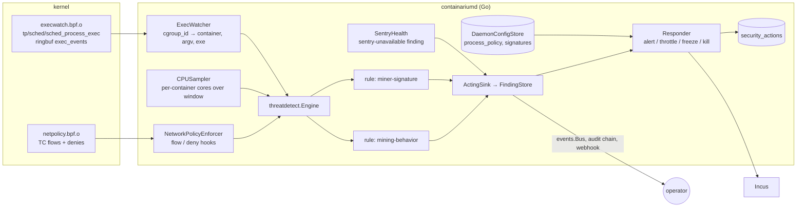

# Design: Process guardrail (mining detection and containment)

**Date:** 2026-10-18
**Status:** proposed
**Stack:** protobuf/gRPC (grpc-gateway) + Docker; Go 1.26 for the daemon, CLI and
MCP wrapper; C (clang, BPF target) for the kernel program, as already used by
the network-policy object. No Python or TypeScript component.

PRD: [`docs/product/process-exec-guardrail.md`](../product/process-exec-guardrail.md)
(stories #2634–#2639). Extends
[Continuous threat detection](continuous-threat-detection.md): same engine,
same finding store, same notifier, same CLI tree. Read that document first;
this one describes only what is added.

## Problem

The sentry sees eBPF flow records and deny events and raises findings. It
cannot see processes, it never acts, and when it is not running nobody is
told. A miner uploaded into a box runs until a cloud provider notices. This
design adds a host-side exec signal, two rules that recognise mining, a
policy that turns a HIGH finding into a reversible action, and a health
finding for a sentry that should be running and is not.

## Design



### Components

1. **ExecWatcher** — `internal/netbpf/execwatch.go` (loader) +
   `internal/server/exec_watcher.go` (cgroup resolution). A second BPF
   object, `execwatch.bpf.o`, built by the same `make build-bpf` target and
   embedded under the same `embed_bpf` tag. It attaches one program to the
   `sched/sched_process_exec` tracepoint. The program walks the task's
   cgroup ancestors with `bpf_get_current_ancestor_cgroup_id(level)` for
   `level` in `[1, 12]` and looks each id up in a hash map
   `watched_cgroups{cgroup_id → container_index}` populated from
   userspace; a miss at every level means a host or core-infra process and
   the program returns without emitting. A hit emits one record to a
   `BPF_MAP_TYPE_RINGBUF` (`exec_events`, 1 MiB):
   `{host_pid, ppid, uid, cgroup_id, comm[16], filename[256],
   argv[512], argv_truncated}`. `argv` is read from `mm->arg_start` with
   CO-RE (`vmlinux.h`, kernel BTF required); `filename` comes from the
   tracepoint's `__data_loc`. Environment variables are never read.

   Userspace keeps `watched_cgroups` in sync with running containers: on
   the enforcer's 10 s reconcile it reads each container's init PID from
   Incus, resolves `/proc/<pid>/cgroup` to a path (the helper already in
   `pkg/core/incus/cpu_stat.go`), stats `/sys/fs/cgroup/<path>` for the
   inode (which is the cgroup id the kernel reports), and upserts the map.
   Stopped containers are deleted from the map. Events are decoded into a
   typed `netbpf.ExecEvent`, the container name is attached, and the event
   is handed to the engine and to a bounded fan-out for the streaming RPC.
   A missing tracepoint, missing BTF, or a verifier rejection is reported
   as `exec-telemetry: unavailable (<reason>)` in `GetSentryStatus`; the
   flow rules and the network-policy object are unaffected because the
   objects are separate.

2. **CPUSampler** — `internal/server/cpu_sampler.go`. On each tick of the
   existing metrics collector (which already reads
   `ContainerMetrics.CPUUsageSeconds` per container from Incus), the
   sampler takes the delta since the previous tick, converts it to cores
   (`Δseconds / Δwall`), and pushes `[]threatdetect.CPUSample{Container,
   Tenant, Cores, LimitCores, At}` into the engine (`LimitCores` is the box's
   `limits.cpu`, 0 when unlimited). Where the collector runs, the sampler
   is a hook on it, like the flow hook on the enforcer, and adds no Incus
   polling. The collector only runs when a metrics export target is
   configured, so on a backend without one (BYOC hosts export no metrics)
   the sampler runs its own 30 s ticker (the collector's default interval) over the same `GetContainerMetrics`
   read and feeds the same path; never both at once, and `sentry status`
   names the source (decided on #2641 Q4). A container's first sample
   after start is dropped (no delta).

3. **Engine extension** — `internal/threatdetect/engine.go`. The `Rule`
   interface is unchanged. Two optional interfaces let a rule receive the
   new signals without touching the five existing rules:

   ```go
   type CPUConsumer interface  { OnCPU(ctx RuleContext, samples []CPUSample) []RawFinding }
   type ExecConsumer interface { OnExec(ctx RuleContext, ev ExecEvent) []RawFinding }
   ```

   The engine type-asserts on registration and fans out accordingly, with
   the same per-rule panic recovery and health tracking.

4. **Rule: mining-behavior** — `internal/threatdetect/rule_mining.go`.
   Implements `Rule` (uses `OnFlows` and `Sweep`) and `CPUConsumer`. Per
   container it keeps a ring of CPU samples covering `window` (default
   5 min) and a map of candidate flows: any flow whose destination port is
   in the stratum set (default 3333, 4444, 5555, 7777, 14444, 14433) or
   whose destination matches the bad-destination matcher (shared with
   `rule_baddest.go`, injected). A flow's age is `LastNs - FirstNs` from
   the flow record itself; the rule only needs it to be `≥ flow_min_age`
   (default 3 min) and seen inside the window. `Sweep` (30 s) fires a HIGH
   finding when the window's mean cores is at least
   `min(min_cores, min_fraction_of_limit × limits.cpu)` (defaults 1.5 and
   0.75; a box with no CPU limit uses `min_cores` alone, decided on #2641
   Q1) and a qualifying flow exists. The box's limit arrives with each
   `CPUSample` from the same Incus read the sampler already does. Subject is the destination `ip:port`, so a
   second pool opens a second finding and the same pool dedupes. Evidence:
   one `CPUEvidence{mean_cores, peak_cores, window_seconds, samples}` and
   the qualifying `FlowEvidence`. Thresholds live in `ProcessPolicy`
   (below) and reach the rule through `RuleContext`, so the rule stays
   pure. State per container is dropped when no sample arrives for
   `2 × window`.

5. **Rule: miner-signature** — `internal/threatdetect/rule_minersig.go`.
   Implements `Rule` (no-op flow methods) and `ExecConsumer`. A
   `SignatureSet` compiled from the embedded baseline
   (`rule_minersig_list.yaml`, versioned like the bad-destination list)
   plus operator entries persisted under
   `threatdetect.miner_signatures.operator` in `DaemonConfigStore`. Three
   matcher kinds, each a typed entry: `name` (exact or glob on the
   basename of `filename` and on `comm`), `argv` (literal substring over
   the joined argv), `sha256` (hex of the executable). Name and argv match
   in the hot path. The hash matcher runs only when the set has hash
   entries and no cheaper matcher hit: the watcher hashes
   `/proc/<pid>/exe` (cap 64 MiB, 200 ms budget, best effort; the process
   may already be gone) outside the engine goroutine and feeds a second
   `OnExec` with `ev.SHA256` filled. A hit is a HIGH finding, subject
   `<matcher kind>:<entry>`, evidence one `ExecEvidence{pid, ppid, uid,
   comm, filename, argv, sha256, matched}`.

6. **SentryHealth** — `internal/server/sentry_health.go`. A 60 s loop
   that compares `GetSentryStatus` to "armed" (`CONTAINARIUM_THREAT_SENTRY`
   set). When armed and the state is `UNAVAILABLE` or `DEGRADED`, or any
   rule is unhealthy, or exec telemetry is unavailable, it upserts a
   MEDIUM finding `SENTRY_UNAVAILABLE` with subject = the reason string and
   `ConfigEvidence{note: reason}`. When the state returns to `OK` it
   resolves the open finding. Unarmed daemons never run the loop. This is
   deliberately not a `Rule`: a rule cannot run when the engine cannot.

7. **ProcessPolicy + Responder** — `internal/server/process_responder.go`,
   with the pure parts in `internal/threatdetect/policy.go`. The policy is
   a proto message persisted in `DaemonConfigStore` as protojson under
   `threatdetect.process_policy` (backend default) and
   `threatdetect.process_policy.container.<name>` (per-container override,
   written by `SetProcessPolicy{container: …}`; the cloud sets these from
   plan and account age, cloud#2695). Effective policy = container override
   → backend default → `{action: ALERT, kill_process: false}`.

   `ActingSink` wraps the existing `FindingSink`: after a successful
   `Upsert` it calls `Responder.OnFinding(before, after)`. The responder
   acts only when the finding is HIGH, its rule is `MINING_BEHAVIOR` or
   `MINER_SIGNATURE`, and no open row in `security_actions` exists for the
   container (dedupe across rules: one action per box). When the finding
   store is degraded (no Postgres) the responder applies `ALERT` only,
   whatever the policy says, and `GetSentryStatus` reports
   `DEGRADED (no persistence): responses disabled` (decided on #2641 Q2):
   a throttle whose previous-limit row can vanish on restart is worse than
   an alert. Actions:

   | action | apply | release |
   |---|---|---|
   | `ALERT` | nothing beyond the finding | — |
   | `THROTTLE` | read current `limits.cpu`/`limits.cpu.allowance`, store them, `SetCPULimit(name, throttle_allowance)` | `SetCPULimit(name, stored)` |
   | `FREEZE` | `Incus UpdateInstanceState{Action: "freeze"}` (new `FreezeContainer`/`UnfreezeContainer` on the client interface) | `unfreeze` |
   | `kill_process` (additive, signature rule only) | re-read `/proc/<pid>/cgroup`, confirm it still maps to the same container, `SIGKILL` | — |

   Every action writes an audit entry (`security.action`), emits
   `EVENT_TYPE_SECURITY_FINDING` with the updated finding, and updates the
   finding's `response` field. `ReleaseProcessAction` reverses it, marks
   `released_by`, and resolves the finding with `remediated=true`. A TTL
   sweep (60 s) releases expired actions and upserts a MEDIUM
   `PROCESS_ACTION_EXPIRED` finding so an unattended throttle does not
   silently become permanent (the `auto_quarantine.go` backstop, same
   24 h default). Incus failures are recorded on the action row with
   `error` and surfaced in the finding; the responder never retries in a
   loop (the next `Sweep` of the rule re-fires the finding, which is the
   retry). The responder depends on a small interface, not on
   `*incus.Client`:

   ```go
   type containerActuator interface {
       CPULimit(name string) (count, allowance string, err error)
       SetCPULimit(name, cpu string) error
       Freeze(name string) error
       Unfreeze(name string) error
       InitPID(name string) (int, error)
   }
   ```

8. **API + CLI + MCP** — additions to
   `proto/containarium/v1/threatdetection.proto` (contract below),
   implemented in `internal/server/threatdetect_server.go`; cobra verbs
   under `containarium security` (`process-policy get|set|release`,
   `miner-signatures list|add|remove`, `exec-events`); MCP tools in
   `internal/mcp/tools.go` as thin wrappers over the generated client.
   The streaming RPC backs `exec-events --follow`; the CLI prints one
   line per event.

### Data flow

Happy path, behavioural: collector tick (30 s default) → `CPUSampler` → engine →
`mining-behavior` ring; flow poll (15 s) → enforcer hook → engine →
candidate flow; `Sweep` (30 s) → HIGH finding → `ActingSink` →
`FindingStore` (event bus, audit) → `Responder` reads effective policy →
`SetCPULimit` → action row + audit + finding update → webhook. Worst case
from the window being satisfied to the throttle applied: 30 s sweep +
one Incus call. The PRD's 10 min containment target is dominated by the
5 min window and 3 min flow age, both operator-tunable.

Happy path, signature: exec in box → ringbuf → `ExecWatcher` decode and
attribute (< 1 ms) → `OnExec` → HIGH finding → responder (→ kill if
enabled) → policy action. Target < 10 s end to end; measured in the e2e.

Failure paths: exec object fails to load → exec telemetry unavailable,
flows and CPU rules keep running, `SentryHealth` raises the MEDIUM finding;
ringbuf full → `lost` counter incremented and reported in status, no
crash; Incus call fails → action row carries the error, finding says
`response: FAILED`, operator alerted; Postgres absent → `security_actions`
degrades to the in-memory ring exactly like findings and `sentry status`
says `DEGRADED (no persistence)`; a false positive → `release` in one
command, previous limit restored from the row; pid reuse between finding
and kill → the cgroup re-check refuses the kill and records
`kill_skipped: pid reused`.

### Data model

```sql
CREATE TABLE IF NOT EXISTS security_actions (
  id              BIGSERIAL PRIMARY KEY,
  finding_id      BIGINT      NOT NULL REFERENCES security_findings(id),
  container       TEXT        NOT NULL,
  tenant_id       TEXT        NOT NULL,
  action          TEXT        NOT NULL,            -- pb.ProcessAction name
  prev_cpu_count  TEXT        NOT NULL DEFAULT '',
  prev_cpu_allow  TEXT        NOT NULL DEFAULT '',
  killed_pid      INTEGER,
  error           TEXT        NOT NULL DEFAULT '',
  applied_at      TIMESTAMPTZ NOT NULL,
  expires_at      TIMESTAMPTZ NOT NULL,
  released_at     TIMESTAMPTZ,
  released_by     TEXT        NOT NULL DEFAULT ''  -- 'operator' | 'ttl' | 'resolve'
);
CREATE UNIQUE INDEX IF NOT EXISTS security_actions_open_per_container
  ON security_actions (container) WHERE released_at IS NULL;
```

Policy and signature lists are protojson / JSON in `DaemonConfigStore`
under the keys named above; no new tables. The embedded YAML lists are
parsed into typed structs at startup and rejected at build time by a test
if malformed.

## Language choices

| Component | Language | Why this one | Type gate in CI |
|-----------|----------|--------------|-----------------|
| ExecWatcher loader, CPUSampler, rules, responder, server, CLI, MCP | Go | the daemon is Go; rules must stay pure and table-testable in the existing engine | `go vet`, `go build`, golangci-lint v2 |
| `execwatch.bpf.c` | C (BPF) | the only language the kernel verifier accepts; same toolchain, Makefile target and CI loading lane as `netpolicy.bpf.c` | `clang -target bpf` build + the eBPF loading lane (`docs/EBPF-CI-LOADING-LANE-DESIGN.md`) verifies it against a real kernel |

No Python, no TypeScript. The cloud dashboard (cloud#2695) consumes the
generated TypeScript client from the proto as it does for findings today.

## Contracts

`proto/containarium/v1/threatdetection.proto` gains (all generated into
Go server stubs, grpc-gateway REST, OpenAPI and the TS client; nothing
hand-edited):

```proto
enum ThreatRuleId {
  // existing 0..5
  THREAT_RULE_ID_MINING_BEHAVIOR        = 6;
  THREAT_RULE_ID_MINER_SIGNATURE        = 7;
  THREAT_RULE_ID_SENTRY_UNAVAILABLE     = 8;
  THREAT_RULE_ID_PROCESS_ACTION_EXPIRED = 9;
}

message CPUEvidence  { double mean_cores = 1; double peak_cores = 2; int64 window_seconds = 3; int32 samples = 4; }
message ExecEvidence { uint32 pid = 1; uint32 ppid = 2; uint32 uid = 3; string comm = 4; string filename = 5;
                       string argv = 6; bool argv_truncated = 7; string sha256 = 8; string matched = 9; }
message Evidence { /* existing 1..4 */ repeated CPUEvidence cpu = 5; repeated ExecEvidence execs = 6; }

enum ProcessAction { PROCESS_ACTION_UNSPECIFIED = 0; PROCESS_ACTION_ALERT = 1;
                     PROCESS_ACTION_THROTTLE = 2; PROCESS_ACTION_FREEZE = 3; }
enum ResponseState { RESPONSE_STATE_UNSPECIFIED = 0; RESPONSE_STATE_NONE = 1; RESPONSE_STATE_APPLIED = 2;
                     RESPONSE_STATE_FAILED = 3; RESPONSE_STATE_RELEASED = 4; RESPONSE_STATE_EXPIRED = 5; }
message FindingResponse { ProcessAction action = 1; ResponseState state = 2; bool process_killed = 3;
                          google.protobuf.Timestamp applied_at = 4; google.protobuf.Timestamp expires_at = 5;
                          google.protobuf.Timestamp released_at = 6; string released_by = 7; string error = 8; }
message Finding { /* existing 1..12 */ FindingResponse response = 13; }

message MiningBehaviorThresholds { double min_cores = 1; google.protobuf.Duration window = 2;
                                   google.protobuf.Duration flow_min_age = 3; repeated uint32 stratum_ports = 4;
                                   double min_fraction_of_limit = 5; }  // bar = min(min_cores, fraction × limits.cpu)
message ProcessPolicy { ProcessAction action = 1; string throttle_allowance = 2; google.protobuf.Duration ttl = 3;
                        bool kill_process = 4; MiningBehaviorThresholds mining_behavior = 5; }

message GetProcessPolicyRequest  { string container = 1; }   // empty = backend default
message GetProcessPolicyResponse { ProcessPolicy policy = 1; bool is_override = 2; ProcessPolicy effective = 3; }
message SetProcessPolicyRequest  { string container = 1; ProcessPolicy policy = 2; bool clear_override = 3; }
message SetProcessPolicyResponse { ProcessPolicy effective = 1; }
message ReleaseProcessActionRequest  { string container = 1; }
message ReleaseProcessActionResponse { Finding finding = 1; }

enum MinerSignatureKind { MINER_SIGNATURE_KIND_UNSPECIFIED = 0; MINER_SIGNATURE_KIND_NAME = 1;
                          MINER_SIGNATURE_KIND_ARGV = 2; MINER_SIGNATURE_KIND_SHA256 = 3; }
message MinerSignature { MinerSignatureKind kind = 1; string pattern = 2; string label = 3; bool builtin = 4; }
message ListMinerSignaturesRequest {} message ListMinerSignaturesResponse { repeated MinerSignature signatures = 1; string baseline_version = 2; }
message AddMinerSignatureRequest { MinerSignature signature = 1; } message AddMinerSignatureResponse { MinerSignature signature = 1; }
message RemoveMinerSignatureRequest { MinerSignatureKind kind = 1; string pattern = 2; } message RemoveMinerSignatureResponse {}

message ExecEvent { string container = 1; string tenant_id = 2; google.protobuf.Timestamp at = 3; ExecEvidence exec = 4; }
message StreamExecEventsRequest { string container = 1; }

service ThreatDetectionService {
  // existing RPCs
  rpc GetProcessPolicy(GetProcessPolicyRequest) returns (GetProcessPolicyResponse)
      { option (google.api.http) = { get: "/v1/security/process-policy" }; }
  rpc SetProcessPolicy(SetProcessPolicyRequest) returns (SetProcessPolicyResponse)
      { option (google.api.http) = { put: "/v1/security/process-policy" body: "*" }; }
  rpc ReleaseProcessAction(ReleaseProcessActionRequest) returns (ReleaseProcessActionResponse)
      { option (google.api.http) = { post: "/v1/security/process-policy/release" body: "*" }; }
  rpc ListMinerSignatures(ListMinerSignaturesRequest) returns (ListMinerSignaturesResponse)
      { option (google.api.http) = { get: "/v1/security/miner-signatures" }; }
  rpc AddMinerSignature(AddMinerSignatureRequest) returns (AddMinerSignatureResponse)
      { option (google.api.http) = { post: "/v1/security/miner-signatures" body: "*" }; }
  rpc RemoveMinerSignature(RemoveMinerSignatureRequest) returns (RemoveMinerSignatureResponse)
      { option (google.api.http) = { delete: "/v1/security/miner-signatures/{kind}/{pattern}" }; }
  rpc StreamExecEvents(StreamExecEventsRequest) returns (stream ExecEvent)
      { option (google.api.http) = { get: "/v1/security/exec-events" }; }
}
```

`GetSentryStatusResponse` gains `string exec_telemetry = N` (`ok` or
`unavailable: <reason>`) and `int64 exec_events_lost = N+1`.

Kernel ↔ daemon: the `exec_event` struct is the wire contract between
`execwatch.bpf.c` and `netbpf.ParseExecEvent`; a Go test pins
`unsafe.Sizeof` and field offsets against constants shared with the C
header, as `ParseDenyEvent` does today. The parser tolerates longer samples
so a newer object loads on an older daemon.

Authorization: all new RPCs are admin-scoped like the existing
bad-destination verbs; the cloud shim forwards them per org as it does
`ListFindings` (the shim is the tenant boundary, see
`internal/ossshim/threatdetect.go`).

## Test strategy

**ExecWatcher**
- Unit (`netbpf`): `TestParseExecEvent` table over well-formed, padded,
  truncated-argv and oversize samples; `TestExecEventWireLayout` pins
  size and offsets.
- Unit (`server`): `TestCgroupIDForContainer` on a fake `/proc` and
  `/sys/fs/cgroup` tree (temp dir); `TestWatchedCgroupsReconcile` adds,
  keeps and removes entries for started, running and stopped containers.
- Loading lane (real kernel, existing eBPF CI VM): object loads, map is
  writable, a child `sh -c true` in a cgroup registered in the map yields
  exactly one event with the right `cgroup_id`, and a host exec yields
  none. Drop counter test: fill the ring with a 10k-exec burst and assert
  `exec_events_lost` is reported, not panicked.
- Overhead: a benchmark on the lane host runs 1,000 execs/s for 60 s with
  and without the program attached; the delta goes in the operator doc
  and must be < 1 % of one core.

**CPUSampler**
- Unit: `TestCPUSamplerDeltas` table: first sample dropped, steady 2.0
  cores, counter reset on container restart (negative delta → dropped),
  clock skew guarded.

**Engine extension**
- Unit: `TestEngineFansOutOptionalInterfaces`: a rule implementing only
  `Rule` receives no CPU/exec calls; one implementing all three receives
  all; a panicking `OnExec` marks that rule unhealthy and the others keep
  running (reuses the existing recovery test shape).

**mining-behavior**
- Unit (table-driven, fake clock): fires on 5 min at 2.0 cores + 4 min
  flow to `:3333`; fires on a 1-vCPU box at 0.8 cores (75 % of its limit)
  with the same flow; does not fire on that box at 0.6 cores; does not fire on 2.0 cores with only `:443` flows; does
  not fire on 0.4 cores with a `:3333` flow; fires once per destination
  and dedupes on repeat; state expires after `2 × window`; thresholds from
  `RuleContext` are honoured; a bad-destination hit on `:443` qualifies.
- Replay: `TestMiningBehaviorReplaysOctoberIncident` feeds the recorded
  shape (16 cores, 20-minute flow to `:3333`) and asserts one HIGH finding
  within one sweep.

**miner-signature**
- Unit: matcher table over `xmrig`, `/tmp/.x/xmrig`, `XMRig` (case),
  `gcc --donate-level` (argv hit despite benign name), `node` with a
  `stratum+tcp://` argument, `gcc -O2` (no hit), a sha256 hit, operator
  add/remove round trip through a fake config store, malformed baseline
  YAML rejected.
- Build-time: `TestMinerSignatureBaselineParses` fails the build on a bad
  embedded list.

**SentryHealth**
- Unit with a fake status source and fake sink: unarmed → no finding;
  armed + `UNAVAILABLE` → one MEDIUM finding with the reason as subject;
  reason change → new subject, old resolved; back to `OK` → resolved;
  flapping within one tick → one row, count incremented.

**Responder + policy**
- Unit with a fake `containerActuator` and fake stores: `ALERT` does
  nothing; `THROTTLE` stores the previous limit and applies the
  allowance; `FREEZE` freezes; a second HIGH finding on the same container
  while an action is open does not act again; `release` restores exactly
  what was stored; TTL sweep releases and raises `PROCESS_ACTION_EXPIRED`;
  actuator error → `FAILED` state with the error, no retry; degraded
  store → `ALERT` applied for a `THROTTLE` policy and status reports
  responses disabled; kill path refuses on cgroup mismatch; effective-policy resolution table (override
  → default → built-in).
- Store integration (real Postgres, existing `store-integration` lane):
  `security_actions` unique open-per-container index, release, TTL query.

**API + CLI**
- Contract: generated client round-trips `Get/SetProcessPolicy` and
  `ListMinerSignatures` against the in-process server; grpc-gateway JSON
  for `SetProcessPolicy` with a `Duration` field; `StreamExecEvents`
  delivers to two subscribers and drops a slow one without blocking the
  watcher.
- CLI: golden-output tests for `process-policy get` and `exec-events`.

**End to end (real Incus backend, the sprint's verification pass)**
1. Policy `THROTTLE`: a box runs a CPU burner plus a loopback TCP server
   on `:3333` that the burner connects to (the test's own "pool", so no
   egress is needed); the allowance drops to `10%` within one cycle;
   `release` restores the original limit. (#2636)
2. Signature: a stub binary named `xmrig` with `--donate-level 1` in a box
   → finding < 10 s, kill when `kill_process=true`, audit row; a stub
   named `gcc` with the same CPU profile → no signature finding. (#2638)
3. Health: start the daemon armed with `CONTAINARIUM_NETWORK_POLICY_BPF_OBJECT`
   pointing at a missing file → `sentry-unavailable` finding and webhook
   delivery within 60 s. (#2634)

## Deviations from the default stack

- **C for the BPF program.** Already a documented deviation for
  `netpolicy.bpf.c`; the same toolchain, Makefile target, embed tag and CI
  loading lane contain it. Kernel floor rises from 5.4 (network object)
  to 5.8 (ringbuf) plus BTF for the exec object only; Ubuntu 22.04 and
  24.04 LTS ship both. A host below that floor loses exec telemetry, not
  flow detection.
- **Second BPF object instead of extending `netpolicy.bpf.o`** (the
  PRD's story 4 said "in the existing object"). The exec program is
  host-global (one tracepoint) while the network program is per-veth; a
  verifier rejection or missing BTF must not take flow enforcement down
  with it; and the network object can stay at its 5.4 floor. Same build,
  same embedding, same lane; only the failure domain is split.
- **Optional interfaces on `Rule`** rather than widening the interface:
  keeps the five shipped rules untouched and the engine's recovery logic
  in one place.

## Rejected alternatives

- **Tetragon / Falco for process events.** They would give exec events
  and more in a day, at the price of a second privileged agent per host,
  its own release cadence and its own rule language, for three rules and
  one tracepoint. The existing eBPF loader, embed and CI lane already pay
  the hard costs. Revisit if the rule set grows past a handful.
- **An agent inside the box** (`auditd`, a sidecar, a cron that greps
  `ps`). The tenant has root and kills it; both incidents already ran as
  root in the box.
- **`sys_enter_execve` tracepoint instead of `sched_process_exec`.** It
  sees argv from user memory without CO-RE, but records attempts
  (including failures) and needs `sys_exit_execve` pairing to know the
  exec succeeded; `sched_process_exec` fires once per successful exec and
  carries the resolved filename. CO-RE and BTF are a smaller cost than the
  pairing state, and the loading lane already runs on a BTF kernel.
- **CPU threshold alone** (the hosted control plane's first detector).
  Catches any busy build farm; cloud#830 recorded the obvious evasion
  (`--max-cpu-usage=50`). Requiring the flow or the signature keeps the
  false-positive rate at a level that can be allowed to act.
- **Kill by default on signature match.** Reversibility is the design
  principle that lets an action run unattended. Decided off everywhere
  (cloud#2697); the per-org override exists for operators who accept the
  risk.
- **Egress block as the action** (reuse `auto_quarantine.go`). It stops
  the pool connection but a miner keeps burning CPU, and deny rules are
  per tenant, so one box's miner would black-hole its siblings. Throttle
  acts on the resource actually being stolen.

## At 10x

A host with 10× the containers or exec rate changes two things: the
`watched_cgroups` reconcile should move from a full rewrite to a diff
against the enforcer's existing container list (same 10 s loop), and the
exec fan-out should drop per-subscriber rather than per-ring (already
designed). The ring buffer size and the 512-byte argv cap are constants to
tune, not structure to change. The responder's one-action-per-container
rule scales with containers, not with findings. If several hosts should
share one signature list or one policy, that is the cloud's reconciler
(cloud#2695), not a daemon change.
