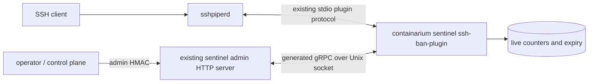

# Design: observable SSH source-IP bans on the sentinel

**Date:** 2026-10-15
**Status:** accepted for implementation
**Related:** [#933](https://github.com/FootprintAI/Containarium/issues/933), [#934](https://github.com/FootprintAI/Containarium/pull/934), [#1996](https://github.com/FootprintAI/Containarium/issues/1996)
**Baseline:** `8b285dde`; Go 1.26.9, sshpiper/libplugin v1.6.1, existing sentinel systemd services and Terraform module.

## Problem and evidence

Shared-NAT automation can exhaust one source IP's failure budget and block otherwise valid clients. Operators need the actual enforcement state, its expiry, and a way to clear one IP without restarting the SSH gateway. SSH error text alone cannot reliably distinguish a ban from a rejected credential.

The repository already reconciles sshpiper units from instance metadata (#934). The remaining gap is not another copy of that reconciler:

- `terraform/modules/containarium/scripts/sshpiper.service.tmpl` still hardcodes `100` failures and `5m`; the anonymous listener has a separate process and the same defaults.
- The pinned [failtoban source](https://github.com/tg123/sshpiper/blob/v1.6.1/plugin/failtoban/main.go) supports `--ignore-ip` for IPs/CIDRs. The module does not expose it.
- The plugin stores counters in its own process. It provides no per-IP query or delete operation; SIGHUP flushes the entire cache. The existing `/sentinel/fail2ban/*` handlers invoke the separate system `fail2ban-client`, so they cannot answer for this plugin. #1996 was closed with a recommendation, not an implementation.
- A new connection initializes a cache entry with an expiry. Auth-failure and pipe-create-error callbacks increment it. Successful connection frequency alone is not the counter. Pipe-create errors can include failures other than bad credentials.
- The pinned [go-cache IncrementInt implementation](https://github.com/patrickmn/go-cache/blob/v2.1.0/cache.go) changes the count without refreshing expiry. The comment about retries extending a ban is an observation to reproduce, not an established property of this version. Re-banning after expiry and a renewed expiry are different events.
- The current brute-force integration test sends only five failed attempts against a default threshold of 100, then logs rather than fails when it finds no ban evidence. It does not prove enforcement.

These are source and tracker findings. Production binary versions, effective configuration, and the historical FaceLabor failure have not been re-verified live.

## Recommended design

Deliver two increments: expose the existing configuration first, then replace only the bundled failtoban plugin with a first-party Go plugin that owns both enforcement and its control interface. Keep sshpiperd, its routing plugins, and session auditing. Use the already-pinned libplugin dependency and an existing `containarium sentinel` subcommand pattern; no upstream daemon fork or new language is required.

The plugin is the single owner of its state. The admin server queries and mutates that state over a local Unix socket. A log reader or a separately reconstructed ban table is not authoritative.

### Components and language choices

| Component | Language | Responsibility | Type gate |
|-----------|----------|----------------|-----------|
| `internal/sentinel/sshban` and `sentinel ssh-ban-plugin` | Go | Atomic policy state, libplugin callbacks, local control service, structured events | `go build`, `go vet` |
| Existing sentinel admin server and diagnostic caller | Go | Admin authentication, generated API mounting, forwarding to the configured listener socket | `go build`, `go vet` |
| Existing provisioning | Terraform HCL and existing Bash | Validate/render policy and install/reconcile the units | Terraform validation, render checks, `bash -n` |

There is no Python or TypeScript component. Protocol-generated Go types carry all new control messages.

## Contracts

### Configuration

Add module inputs `ssh_ban_max_failures` (positive integer, default 100), `ssh_ban_duration_seconds` (positive integer, default 300), and `ssh_ban_ignore_cidrs` (validated IPv4/IPv6 prefixes, default empty). Render both main and enabled anonymous-listener units using the same validated inputs and the existing metadata reconciliation path. Apply strict prefix validation before interpolation into systemd arguments; reject malformed input rather than silently ignoring it.

An exemption skips only source-IP banning. It never authorizes an SSH key or bypasses routing/authorization. Operators may supply narrow, controlled automation egress prefixes; the default does not exempt all public/shared runner networks.

### Enforcement compatibility

The first-party plugin must characterize and preserve v1.6.1's callback accounting and fixed cache-window expiry before replacing it. Initialize a source-IP window at first connection; reaching the threshold rejects subsequent connections until that window expires. Report that actual deadline as `expires_at`. Do not silently redefine the duration as starting at threshold crossing, reset the counter on successful authentication, deduplicate callback failures, or switch to username-based buckets in this delivery. Such changes need their own policy decision and tests.

Use atomic initialization/increment/query/delete with an injected clock. Normalize addresses with `netip.Addr.Unmap`; accept the source address provided by sshpiperd, never a client-supplied forwarding header. Emit structured `failure`, `ban`, `blocked`, `expire`, `unban`, and `policy_loaded` events to the operational logger, never plugin stdout. Distinguish callback kind from verified root cause. Include listener, source IP, count, threshold, actual expiry, policy hash, and process generation. Emit ban/expiry transitions once; bound or sample repeated blocked-event logs.

State remains in-memory like upstream. Restarting this plugin resets its counters; record a new generation so a reset is visible. The API must not present state from a previous generation as current. Prune expired entries before admitting a new source. Bound each listener to 65,536 live source entries initially; at capacity, continue serving tracked sources and reject new untracked sources with a distinct `policy_capacity` operational event. Never evict an active ban to admit a new IP. Load tests must verify the memory bound and this explicit availability tradeoff before rollout.

### Control API

Define `SentinelSSHBanService` in a proposed `proto/containarium/v1/ssh_ban.proto`. Generate Go gRPC, grpc-gateway, and OpenAPI artifacts through the repository's normal proto build. This document does not add or hand-edit generated files.

| RPC | REST mapping | Required input | Result |
|-----|--------------|----------------|--------|
| `GetSSHBan` | `GET /sentinel/ssh-bans/{listener}/{ip}` | Listener enum and one bare IP | State (`CLEAR`, `TRACKING`, `BANNED`, `EXEMPT`), count, expiry, effective policy, generation, sentinel ID, observation time |
| `ListSSHBans` | `GET /sentinel/ssh-bans/{listener}` | Listener enum, bounded page size/token | Current bans and effective policy from that process |
| `UnbanSSHSource` | `POST /sentinel/ssh-bans/{listener}/unban` | One bare IP; operator reason | Whether state was cleared; generation and observation time |

Use `google.protobuf.Timestamp` for times, a typed policy message, and enums for listener/state/event kinds. Reject missing/unknown listeners, invalid IPs, and CIDRs used as unban targets. Unban clears the selected IP's counter as well as its ban, atomically; it never resets other IPs. A subsequent real failure can start a new counter window.

The plugin serves the generated service on a mode-0600 Unix socket beneath a root-owned runtime directory. Main and anonymous listeners have distinct configured sockets and generations; requests never supply a filesystem path. The existing sentinel HTTP server mounts the generated REST handlers behind `auth.SentinelHMACMiddleware(manager.adminSecret)`. The daemon/shared HMAC secret and unsigned requests cannot use these endpoints. No new public gRPC listener is added.

A disabled listener returns a distinct unavailable-listener result. An enabled but unreachable plugin returns `UNAVAILABLE`/HTTP 503, never a successful empty ban list. Responses identify one sentinel and one listener; inspecting one sentinel is not a fleet-wide result. Keep the existing system fail2ban routes separate and identify their mechanism explicitly in diagnostics.

### Diagnostics and retry behavior

Operators can distinguish `source IP banned until T`, an authoritative credential/authorization denial, and an unresolved SSH failure. Do not infer a ban solely from `Permission denied (publickey)` or `Connection closed`. Tenant CI receives no sentinel admin secret; if it lacks an authorized diagnostic path, preserve the original error and say the cause is unresolved.

On authoritative ban evidence, stop active probing until its actual expiry plus jitter, subject to the job deadline. On an authoritative permanent authorization denial, stop and report that denial. Use bounded backoff for transport failures and unresolved failures. Preserve the existing bounded retry across fresh-box keysync propagation; a raw publickey error is not by itself permanent. Continue using one selected identity and connection multiplexing in automation.

Update `docs/SSH-JUMP-SERVER-SETUP.md`: distinguish a failure budget from a successful-connection rate limit, correct obsolete 3/1h text, describe both SSH error signatures, document actual window semantics, and replace blanket rate-limit/retry claims with the diagnostic procedure. Changes to FaceLabor workflows belong in that repository.

## Test strategy

Tests precede each implementation increment:

1. **Policy and plugin:** table-driven tests with a fake clock and real in-memory policy; valid short-lived connections never increase failures; threshold and expiry boundaries match pinned upstream; repeated rejected attempts do not move expiry; IPv4/IPv6 normalization and CIDR exemptions; atomic concurrent first connections; unban A leaves B intact; callbacks retain their characterized accounting; bounded state and event behavior. Run with the race detector and shuffled order.
2. **Contracts and admin boundary:** generated clients call the real local control service over a temporary Unix socket. Exercise the actual sentinel HTTP route table with valid admin signatures, unsigned requests, and the wrong/shared secret. Verify invalid IP/listener rejection, pagination, missing-socket 503, per-listener isolation, and idempotent single-IP unban. Assert rejected callers cannot touch state.
3. **Provisioning:** render both units at defaults and with narrow exemptions; reject invalid prefixes/durations/thresholds; validate Terraform and shell syntax. Verify a metadata update reaches effective configuration and reports the expected hash. Installing the reconcile timer on an older VM is an explicit deployment step; changing metadata alone does not install a missing timer.
4. **Real SSH integration:** use ephemeral local processes with the pinned sshpiperd, a real routing plugin/backend, the built first-party plugin, and clients with separate loopback source IPs. At a small test threshold, demonstrate successful connection bursts, an actual ban, correct/incorrect keys sharing an IP, isolated unban, recovery at the fixed deadline despite probing, and callback parity with upstream. Use readiness polling and guaranteed teardown. Assert outcomes through both SSH and the generated control client; matching a log word is insufficient proof. CI runs this on a clean Ubuntu runner with the race detector; missing prerequisites fail the job.

## Delivery and deployment

1. Land validated Terraform inputs, corrected diagnostics/documentation, and meaningful enforcement characterization. Keep default policy values at 100/300s.
2. Land the first-party plugin, generated control contract, protected admin mount, and real integration coverage. Ship it in the existing daemon binary, not as an additional artifact pipeline. Verify the installed binary supports the subcommand before publishing any unit that invokes it.
3. Roll out one sentinel/listener first. Verify its effective policy hash, API authorization, valid SSH, controlled test-IP ban/unban, and session audit continuity before proceeding. Schedule the required sshpiperd restart because it can interrupt existing sessions. Rollback restores the upstream-plugin unit with the same policy; it resets counters and also requires a restart.

Implementation follows this document in #933. Production deployment and live fleet verification remain separate work; the implementation PR does not deploy or claim live verification.

## Deviations from the default stack

The sentinel SSH service remains host-managed by systemd. It is already installed with a stable public listener and real source-IP visibility; containerizing production SSH would add a networking migration unrelated to this issue. Integration tests launch the actual pinned binaries as disposable local processes rather than adding a container runtime requirement; loopback source binding supplies distinct real transport identities. Terraform and Bash stay confined to existing provisioning. New control boundaries use protobuf/gRPC and generated REST handlers.

## Rejected alternatives

- **Only increase the threshold or restart sshpiper to clear bans:** no authoritative inspection or targeted remediation; restarts also interrupt sessions and clear unrelated counters.
- **Parse logs into a ban table:** callbacks, expiry, restarts, and manual resets can diverge from reconstructed state. Operational events are evidence, not enforcement state.
- **Move enforcement to a fail2ban firewall jail:** it could reuse the existing admin CLI, but changes the enforcement layer and SSH failure signature while introducing log-parser and firewall lifecycle dependencies. The established Go plugin boundary provides a smaller behavior migration.
- **Promise an SSH banner immediately:** a ban can reject a connection before banner delivery. A real-client spike must establish a supported delivery point before this becomes an acceptance criterion; authoritative admin diagnostics do not depend on it.

At ten times the current source-IP cardinality, measure policy memory and control-list pagination before changing topology. Keep state local to each sentinel/listener unless a separate fleet-wide enforcement requirement is established.
