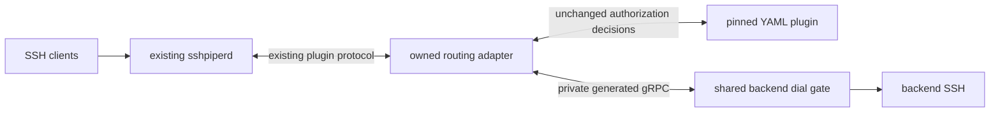

# Design: bounded SSH reconnects to an unavailable backend

**Date:** 2026-10-15
**Status:** implementation spike in progress; host-address contract revised below; aggregate budget/recovery acceptance clarification pending
**Related:** [#1138](https://github.com/FootprintAI/Containarium/issues/1138), [#2556](https://github.com/FootprintAI/Containarium/pull/2556), #933
**Stack:** existing Go sentinel daemon, protobuf/gRPC, pinned SSHPiper v1.6.1 and host-managed systemd services.
**Reassessment snapshot:** 2026-10-15 08:10 UTC; upstream and scarlet8714 fork `main` both `78186195b9aa9618d950922be506657f2aa9742c`. Only merged upstream commits were synchronized to the fork; open PRs were inspected separately.

## Problem and evidence

#1138 reports repeated upstream SSH connections during a backend outage, followed by the backend's fail2ban banning the sentinel. Characterization on `7f979bae`, repeated on current main `78186195`, proves amplification within one downstream SSH connection: one authorized identity causes seven backend connect calls with both Go SSH and OpenSSH; twelve clients cause 84 calls. OpenSSH records six partial-success responses and seven offers of the same key. Three candidate keys produce nine calls. Seven is an observed count for these inputs, not a universal cap.

After the failed client disconnects, a two-minute observation on `7f979bae` finds no background redials. Both the owned and bundled failtoban plugins produce the seven-call result, so #2556 did not introduce the amplification. The new tests characterize existing behavior; they are not evidence of a completed fix. The complete related package passed again on `78186195` in 15.771 seconds, including the eight characterization scenarios and existing enforcement/parity tests. The detailed local report is [here](/tmp/containarium-1138-tests/docs/testing/ssh-upstream-retry-characterization.md).

The backend-ban claim still needs real sshd/fail2ban evidence. The repository's [backend provisioning](https://github.com/FootprintAI/Containarium/blob/78186195b9aa9618d950922be506657f2aa9742c/terraform/modules/containarium/scripts/startup-spot.sh) explicitly configures maxretry=3, findtime=600s and bantime=3600s; its default whitelist input is 10.0.0.0/8, and the generated ignore list also includes loopback. Establish the backend-visible source IP, effective jail settings and matching auth-log records in each topology. A refused TCP dial creates no authenticated sshd session and alone does not prove a jail match. Do not remove existing exemptions merely to claim the production incident was reproduced.

#2556 gives this repository an owned source-IP ban plugin, policy configuration and live diagnostics. It preserves failure accounting and does not implement connection pacing. Its unban endpoint cannot clear the separate backend jail.

Pinned SSHPiper's `dialUpstream` delegates to `CreateConnCallback` on the plugin that returned the selected upstream. The normal YAML plugin returns that upstream; appending a connection callback to the separate ban plugin does not intercept those dials. `PipeCreateErrorCallback` provides only a remote address and an error string, not an authoritative backend identity or typed transport cause.

Sources: [routing and dialing](https://github.com/tg123/sshpiper/blob/v1.6.1/cmd/sshpiperd/internal/plugin/grpc.go), [plugin contract](https://github.com/tg123/sshpiper/blob/v1.6.1/libplugin/pluginbase.go), [connection stream contract](https://github.com/tg123/sshpiper/blob/v1.6.1/libplugin/connovergrpc/connovergrpc.proto).

## Current main and open-PR compatibility

Main already contains the SSH authorization contract/self-host decider, verified device-approval decision, #2556's owned ban plugin, and #2552's opt-in direct-jump-host AuthorizedKeysCommand. The last one preserves static authorized_keys for the sentinel's upstream key. A transport fix must preserve both direct-login and proxied-login behavior.

The following is a snapshot of inspected heads, not a proposal to merge unfinished branches into the fork:

| PR and inspected head | Current evidence | Consequence for #1138 |
|---|---|---|
| [#2537](https://github.com/FootprintAI/Containarium/pull/2537), `7fb081a3` | Eight Actions runs conclude `action_required`; the latest head has no passing Actions gate. CodeRabbit's docstring warning is 10%. The author's merge/local lint fixes supersede the older compile/lint failure, but are not CI proof. | Adds an audit-only sentinel check, a private route/authorization bridge and a bounded positive cache. Keep its backend/login/fingerprint cache and metadata separate from dial budgets. Its ALLOW/DENY metadata cannot be used as an enforcement decision. Preserve its placement before the session observer when integrating routing. |
| [#2541](https://github.com/FootprintAI/Containarium/pull/2541), `1a5a8455` | Actions jobs now pass; supplemental Trivy is neutral. CodeRabbit docstring warning is 47.83%. An active review finding about enrolled-client construction falling back to self-host policy is also visible in the inspected source. | Managed authorization has a 2s cloud deadline; typed UPSTREAM_UNAVAILABLE describes an authorization-source failure. It must not open/reset the SSH transport circuit or permit a local-policy fallback. This PR remains open despite passing Actions. |
| [#2536](https://github.com/FootprintAI/Containarium/pull/2536), `ef0f34eb` | Actions jobs pass; supplemental Trivy is neutral. CodeRabbit docstring warning is 33.33%. The author reports the cloud challenge endpoint returned 404 on Oct 13; successful live rotation remains unverified. | Old/new key fingerprints need separate authorization cache entries, while connections to one backend share a transport budget. Never translate KEY_EXPIRED, UNKNOWN_KEY or NO_ACCESS into a backend-wide transport outage. |
| [#2514](https://github.com/FootprintAI/Containarium/pull/2514), `4d76e543` | Actions including the approval spike pass; docstring coverage is 100%. A local three-way preview conflicts with the already-merged verified decision and workflow content. The broader design remains proposed. | Publickey partial success followed by keyboard-interactive is legitimate device approval. Do not suppress all partial-success messages, all authentication retries or keyboard-interactive to remove the seven-dial symptom. Preserve signature proof and approval metadata. |

Sources for the main review constraints: [#2537's latest-head Actions](https://github.com/FootprintAI/Containarium/actions/runs/38696666863), [#2541's enrollment finding](https://github.com/FootprintAI/Containarium/pull/2541#discussion_r4280061897), and the [verified approval decision on main](https://github.com/FootprintAI/Containarium/blob/78186195b9aa9618d950922be506657f2aa9742c/docs/architecture/ssh-live-authorization.md).

All nine open PRs were screened. #2571's per-subject gated-deploy/policy limits do not guard SSH destinations. #2573's policy-store readiness is not evidence that SSH is ready. #2572's run output, #2569's staging scope and #2502's agent-sandbox dependency do not supply this transport fix. #2502 currently has failing unit/K8s checks; there is no reason to make #1138 depend on that bump. Existing `internal/sentinel/tunnel_backoff.go` backs off the backend-to-sentinel tunnel reconnect, not each sshpiperd-to-backend SSH dial. Reuse established Go/time/rate patterns where useful, without importing unmerged feature policy.

Three-way previews also show shared edits in Manager, daemon wiring and the SSH unit template. An individual PR head can still show the old bundled failtoban because its branch predates #2556; that is not by itself evidence that its diff reverts the new plugin. Preserve the effective merged main chain, CIDR/threshold variables and listener-specific sockets. Source previews are not a successful build/test of every PR combined.

## Recommended design

Implement against current main without depending on the open PRs. Put an admission and retry gate immediately before actual backend dials. Resolve a canonical backend identity, selected destination, route generation and transport type from trusted routing state, then scope budgets by backend/egress identity across client usernames, source IPs and both listeners. Do not rely on a per-connection check: the measured retries happen after that check on the same connection. Keep source-IP bans as a separate policy.

On the main listener, the routing adapter delegates authorization and route selection to the pinned YAML plugin, preserving its upstream authentication, host-key fields, URI identity and connection metadata. It exposes the existing connection-creation hook and uses the shared gate for transport creation. On the anonymous listener, the already-owned anon-door plugin returns the actual upstream, so it must bind the same connection hook at that routing point. Appending a hook to the trailing ban plugin is insufficient. Do not reimplement YAML authorization, bypass credential checks, or advertise this integration as proven before the spike below passes.

### Transport-spike correction: preserve host identity explicitly

The real v1.6.1 spike intercepts every dial and reduces the single-key outage case from seven actual dials to one. However, a correct `known_hosts` entry succeeds through the original YAML route and fails through the initial adapter. `ConnOverGrpc.RemoteAddr()` returns the complete URI, including its scheme and correlation query; `knownhosts` requires a host:port address even when the daemon passes the correct hostname separately. This is a verified contract mismatch, not a reason to omit host verification.

Correction implemented in the opt-in spike: the adapter always advertises the existing typed `VerifyHostKey` callback. Bind the child's exact `KnownHostsData`, selected hostname and actual dialed `net.Conn.RemoteAddr()` to the same connection/attempt capability. If the child advertises its own verifier, forward the unchanged key and metadata with the actual socket address; its verifier still takes precedence over any supplied known-host bytes. Otherwise run the existing `knownhosts` verifier against the child's exact bytes and original selected endpoint. The official x/crypto dependency provides `knownhosts.New` rather than the pinned daemon fork's `NewFromReader`: load a mode-0600 temporary public-key file, immediately parse it and remove it, retaining only the existing checker. Empty data retains the child's existing opt-out; configured malformed, mismatched or revoked keys fail closed. This moves the existing verification operation to the adapter without creating a new authorization policy or modifying the pinned third-party daemon. Never use the client source address as the backend's address, and never accept a verifier request without a matching active attempt.

Before this correction ships, `TestIntegrationSSHUpstreamPinnedHostKey` must pass with the real pinned daemon/YAML for both direct routing and the adapter; a wrong/revoked backend key must fail. Unit tests must pin hostname, actual socket address, exact child bytes, concurrent connection isolation, replay/stale-attempt rejection and child verifier forwarding. Process-local attempt state expires and is bounded; setup callbacks remove it. The source-authentication and approval contract remains delegated to the child.

The connection stream's deadline setters are also no-ops in v1.6.1. Bound the actual TCP dial and pre-session socket lifetime in the adapter, then clear the setup deadline only on attempt-correlated SSH success. Do not assume an SSH client timeout automatically cancels the transport callback.

The gate runs in the existing sentinel daemon, with bounded state and a private Unix socket; it is not a new public service. It validates destinations against the authoritative routing inventory. An unavailable gate rejects new guarded connections rather than silently falling back to unlimited direct dialing. Establishing this data-path dependency needs explicit rollout and rollback steps.

### Backend state

- **Ready:** admit normal traffic. Record actual dial failures separately from credential rejection and ordinary session closure. A backend rejecting the proxy's own upstream credential is a distinct backend setup failure requiring bounded retries and diagnostics, not evidence that the tenant supplied a bad key.
- **Cooling down:** a transport failure starts exponential delays, proposed as 1, 2, 4, 8 seconds up to 30 seconds with bounded jitter. Client attempts do not reset or shorten the deadline. Reject excess attempts promptly; do not accumulate sleeping goroutines or an unbounded connection queue.
- **Recovery probe:** allow one attempt across all clients/listeners. Keep its lease until SSH setup succeeds, fails, or times out; a successful TCP connect alone is insufficient. A failed probe increases the delay. Successful SSH setup clears outage state and restores traffic gradually to avoid a recovery burst.

Use bounded dial/handshake deadlines, expiring probe leases, injected clock/randomness, and an explicit maximum number of tracked backends. Never terminate established sessions to enforce a new-connection limit. One unavailable backend must not suppress other backends.

The route may traverse a loopback listener and reverse tunnel; connecting to that local listener does not prove remote SSH setup succeeded. Require an attempt-correlated PipeStart/setup result to close the recovery circuit. Tunnel reconnection or a trusted backend update may request a budgeted probe, but neither a heartbeat nor policy-store readiness should reopen traffic unconditionally.

### Explicit error and source-ban accounting

| Verified outcome | Backend retry state | Client source-IP failure budget |
|---|---|---|
| Transport connection failure on the selected backend attempt | Start/increase cooldown | Do not attribute this confirmed server-side failure to a bad client credential |
| Backend rejects the configured proxy/upstream credential | Separate backend setup/auth failure; bounded retry, operator/key-reconciliation diagnostic | Do not relabel it as an authoritative tenant-key denial |
| Deliberate backend-cooldown rejection | Keep the current deadline/budget | Do not count this intentional suppression as an extra client authentication failure |
| Tenant credential/signature failure or authoritative access denial | Preserve authorization behavior; no backend-wide transport outage | Keep the applicable existing protection; no blanket failure-callback exemption |
| Authorization source unavailable / positive-cache grace | Existing authorization contract and TTL/grace behavior | No transport conclusion from this fact alone |
| Approval pending / valid publickey then keyboard-interactive | Keep the approval state; backend dial only when routing reaches it | No new failure merely for the legitimate approval transition |

#933 deliberately preserved upstream callback counting, including PipeCreateError. The observed three-outage-attempts ban is therefore expected compatibility, not a newly fixed condition. Changing its treatment for confirmed backend failures is an explicit policy change in #1138. It needs typed, trusted, per-attempt correlation between the route/gate and the ban plugin, plus negative tests proving that bad keys/signatures still consume the intended budget. Do not implement this by matching error strings or skipping every pipe-create error. The current callback's remote-address-only shape does not itself provide that correlation.

Retain a rolling attempt budget during outage/recovery in addition to exponential delays: jitter and an exponential cap alone do not establish a safe number of attempts in a jail window. Measure how many jail-matching failures one admitted SSH setup can produce. Permanent authentication rejection is reported separately and must not be inferred from generic publickey text.

Trusted backend recovery signals may request one earlier probe, subject to the same aggregate budget; they must not reopen unrestricted traffic. If no such signal exists, recovery latency is bounded by the next probe, not guaranteed to be a few seconds. A fully exhausted jail budget can require a longer wait even with a recovery signal.

### Components and language choices

| Component | Language | Responsibility | CI type gate |
|---|---|---|---|
| Routing adapter | Go | Delegate the pinned YAML plugin contract and bind every actual dial to a backend attempt | build, vet |
| Backend dial gate | Go | Shared admission, transport creation, deadlines and recovery state | build, vet, race tests |
| Provisioning | Existing Terraform/Bash | Private socket permissions, listener wiring, validated policy and rollback | template tests, shell syntax |

## Contracts

Reuse generated `libplugin` messages for routing delegation and `ConnOverGrpc` for connection streams. Define any new gate control messages in `proto/containarium/v1/ssh_upstream.proto` before generating code: typed backend/route identity, listener and process generation, connection/attempt ID, probe lease/deadline, retry deadline, setup outcome enum and failure disposition. The adapter and ban observer must correlate outcomes with the exact admitted attempt; stale/duplicate outcomes or another key offer cannot reopen a newer outage generation or suppress an unrelated authentication failure. Preserve destination host-key identity while carrying internal attempt correlation. Never infer a backend from a source IP or use best-effort audit route resolution as enforcement authority.

The existing CreateConn callback does not receive a context argument. Prove a bounded timeout/cancellation path through the connection stream rather than assuming the client's deadline propagates automatically. No cloud-authorization RPC contract needs to change for transport pacing; do not add generic SSH routing retries to #2541's managed authorization forwarder.

No new public admin API is required for the first delivery. Structured operational events identify backend, state transition, generation, retry deadline and outcome. Local protocol messages do not carry new tenant-facing credentials.

## Test strategy and implementation sequence

1. **Characterization (done for dial amplification):** the eight scenarios and two-minute idle observation establish the current behavior. A latest-main package rerun is green locally. Backend jail matching is still outstanding; do not replace that missing result with the dial count.
2. **Transport spike before production changes:** prove the routing adapter intercepts every actual dial, preserves key/certificate authorization and host-key verification, and correlates outcomes through all plugin-chain retries. Include both listeners. If the existing protocol cannot meet those requirements, stop and revise this proposal; do not substitute a sleep in the ban callback.
3. **Gate unit/contract tests:** fake-clock/random tests cover growth/cap/jitter, aggregate rolling budget, one recovery probe, expired/cancelled leases, stale outcomes, concurrency, backend isolation, bounded state and valid route updates. Generated clients exercise the real private socket and connection stream. Add `TestCooldownDoesNotSpendClientBanBudget`, `TestInvalidClientKeyStillConsumesBudget`, `TestReverseTunnelTCPConnectDoesNotMarkSSHReady` and `TestAuthzOutageDoesNotBecomeTransportOutage`.
4. **Real integration:** run a multi-minute backend outage with pinned real sshd and fail2ban configuration. Many clients and both listeners must share the limit; assert no ban in that fixture and recovery under the stated signal/budget conditions. Verify existing sessions and a healthy backend remain usable. CI records attempt counts, effective jail configuration and recovery latency. Do not claim arbitrary production jails are covered by one fixture.
5. **Rollout:** deploy the gate before switching listener metadata; canary one sentinel, verify policy and outcome correlation, then enable both listeners. Account for any required sshpiperd restart. Rollback restores the previous direct routing invocation. Do not deploy this proposed design as part of documenting it.

For compatibility coverage, combine the eventual gate with #2537's audit metadata/cache, #2541's managed timeouts and typed denials, #2536's overlapping old/new keys, and the already-verified approval flow. Test raw keys/certificates, invalid signatures, unknown/revoked/expired keys, approval success/pending/denial and both direct-VPC and tunnel routes. Authorization authority and transport readiness must vary independently. Report CodeRabbit's actual coverage on every implementation PR; no missing-prerequisite skips, weakened guards or local-only CI claims.

Deliver as bounded reviews: first the transport-hook/correlation spike and regression evidence; then the shared gate with explicit failure disposition; finally policy rendering and real sshd/fail2ban proof. None of these requires merging an unfinished authorization PR into fork main first.

## Acceptance criteria requiring clarification

Reword AC1 around measured aggregate backend dial behavior, including multiple auth exchanges on one TCP connection. Replace an unspecified default fail2ban threshold with the exact tested jail configuration, backend-visible source/exemptions and measured matching failures. The provisioned 3/600s jail makes it especially unsafe to claim that a 30s backoff cap alone prevents a ban. Specify recovery latency with and without a trusted recovery signal and with remaining/exhausted attempt budget; low probe rates and unconditional seconds-level recovery cannot both be promised without an additional signal. These are proposed scope corrections, not changes already made to #1138.

## Deviations and alternatives

Keep the existing host-managed SSH/systemd topology; containerizing production SSH would add an unrelated source-IP/network migration. Use containers for the real sshd/fail2ban test fixture where appropriate. No new language or replacement SSH implementation.

Rejected: per-client sleeps or NewConnection-only limiting (misses same-connection amplification), disabling partial success (breaks verified device approval), raising ban thresholds or adding blanket sentinel exemptions (does not control reconnect storms), and dropping routing entries (loses the route and produces misleading authorization failures). Keep existing configured exemptions; characterize their effect rather than silently altering them. A maintained fork of the core daemon is not the initial design; revisit the architecture if the transport spike disproves the plugin path.

At larger scale, measure shared connection-stream overhead and per-backend concurrency before splitting services. Multiple sentinels sharing the same backend-visible egress IP need one shared budget or explicit safe partitioning; independent per-process budgets do not provide a fleet guarantee.
