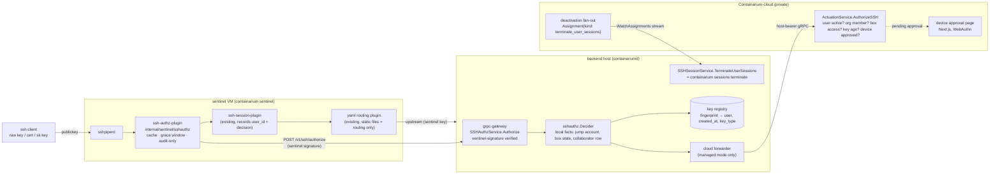

# Design: SSH live authorization — per-connection identity check at the sentinel, device approval, key rotation

**Date:** 2026-10-13
**Status:** proposed
**Decides:** the open design points behind [SSH-LIVE-AUTHORIZATION-DESIGN.md](../SSH-LIVE-AUTHORIZATION-DESIGN.md) (PR #2514, tracking issue #2515): where the authorization call goes, what the contract between the OSS sentinel/daemon and the cloud is, how the OSS half is buildable without the cloud, and which pieces go in which sprint umbrella
**Stack:** protobuf/gRPC (grpc-gateway) + Docker; Go 1.26 for every OSS component and the cloud endpoint; TypeScript + Next.js + Tailwind for the one new cloud web page (device approval)

Out of scope here (specified on #2515, mechanical): doc updates to `SENTINEL-SSH-SESSION-AUDIT.md` and `ISO27001-COMPLIANCE.md` A.6.5, the per-tenant policy flags' admin UI.

## Problem

The sentinel's `sshpiperd` accepts a client key if it appears in a static `authorized_keys` file synced from each backend on a timer. Nothing asks, at connection time, whether the person who registered that key still has access. A departed user keeps every box their key was installed on; `containarium ssh remove` does not reach existing boxes because the propagate RPC is unimplemented; revoking a JWT does not touch SSH; audit rows name a fingerprint, not a person.

Three facts shape the design:

1. **The sentinel has no cloud credential and no user directory.** It authenticates to backends with a shared HMAC secret or an ed25519 signature (`internal/auth/sentinel_ed25519.go`). It knows logins and backends, nothing about people.
2. **The backend daemon already talks to the cloud** over the `ActuationService` gRPC channel with a host bearer (`internal/cloud/client.go`), and already owns the per-box facts the decision needs: jump accounts, collaborators, box state. A self-host daemon has no cloud at all.
3. **The OSS half must be buildable by a public contributor who cannot run the cloud.** The contract therefore lives in OSS proto, and the daemon must be able to answer it from local state.

So the authorization call goes **sentinel → backend daemon**, and the daemon either answers locally (self-host) or forwards to the cloud (managed). One contract, one sentinel code path, zero new trust relationships.

## Design



### Component 1 — contract: `proto/containarium/v1/ssh_authz.proto` (OSS, lands first)

Served by the daemon over gRPC and grpc-gateway. Everything else is built against this.

```proto
service SSHAuthzService {
  // Authorize decides whether the credential offered to the sentinel may
  // open a session as `login` on this backend, right now.
  rpc Authorize(AuthorizeSSHRequest) returns (AuthorizeSSHResponse) {
    option (google.api.http) = { post: "/v1/ssh/authorize" body: "*" };
  }
}

message AuthorizeSSHRequest {
  string login = 1;                    // SSH username presented (jump account)
  SSHCredential credential = 2;        // what was offered
  string client_ip = 3;
  string sentinel_id = 4;              // informational, never authorization
  string approval_id = 5;              // set on re-poll during device approval
}

message SSHCredential {
  oneof kind {
    SSHPublicKeyCredential public_key = 1;   // raw or sk key
    SSHCertificateCredential certificate = 2;
  }
}
message SSHPublicKeyCredential {
  string fingerprint_sha256 = 1;
  SSHKeyType key_type = 2;             // ED25519, RSA, ECDSA, SK_ED25519, SK_ECDSA
}
message SSHCertificateCredential {
  string key_id = 1; uint64 serial = 2; string ca_fingerprint_sha256 = 3;
}

enum SSHKeyType { SSH_KEY_TYPE_UNSPECIFIED = 0; SSH_KEY_TYPE_ED25519 = 1; SSH_KEY_TYPE_RSA = 2;
                  SSH_KEY_TYPE_ECDSA = 3; SSH_KEY_TYPE_SK_ED25519 = 4; SSH_KEY_TYPE_SK_ECDSA = 5; }

message AuthorizeSSHResponse {
  SSHAuthzDecision decision = 1;
  SSHDenyReason deny_reason = 2;       // set when decision == DENY
  string user_id = 3;                  // set when known, DENY included (for audit)
  google.protobuf.Duration cache_ttl = 4;   // positive cache lifetime at the sentinel
  SSHDeviceApproval approval = 5;      // set when deny_reason == APPROVAL_PENDING
}
enum SSHAuthzDecision { SSH_AUTHZ_DECISION_UNSPECIFIED = 0; SSH_AUTHZ_DECISION_ALLOW = 1; SSH_AUTHZ_DECISION_DENY = 2; }
enum SSHDenyReason {
  SSH_DENY_REASON_UNSPECIFIED = 0;
  SSH_DENY_REASON_UNKNOWN_KEY = 1;
  SSH_DENY_REASON_USER_INACTIVE = 2;
  SSH_DENY_REASON_NO_ACCESS = 3;
  SSH_DENY_REASON_KEY_EXPIRED = 4;
  SSH_DENY_REASON_APPROVAL_PENDING = 5;
  SSH_DENY_REASON_APPROVAL_DENIED = 6;
  SSH_DENY_REASON_UPSTREAM_UNAVAILABLE = 7;   // daemon could not reach the cloud
}
message SSHDeviceApproval {
  string approval_id = 1; string code = 2; string url = 3;
  google.protobuf.Duration poll_after = 4; google.protobuf.Timestamp expires_at = 5;
}
```

**Authentication of the caller.** The generated gateway handler for this one service is mounted behind the existing sentinel verifier (`auth.SentinelVerifier.VerifyRequest`, the pattern `internal/gateway/anon_door_mount.go` already uses), not behind a JWT. Reason: this is sentinel-to-daemon plumbing, read-only, and the audit-ingest design's objection to the shared secret (a compromised daemon could forge *writes* on peers) does not apply to a query. The gain is zero operator setup: fail-closed enforcement never depends on a token someone forgot to register. The contract is still proto, so the types, the OpenAPI entry and the typed client are generated.

**Mirror on the cloud channel.** `proto/containarium/cloud/v1/actuation_service.proto` (also in this repo) gains `rpc AuthorizeSSH(AuthorizeSSHRequest) returns (AuthorizeSSHResponse)` reusing the same messages, called by the daemon with its host bearer. The cloud implements it; the daemon's forwarder is a one-call passthrough. Because both RPCs share one message set, the daemon never translates, and a change to a deny reason is one proto edit.

**Fan-out.** `Assignment` gains `kind` with a `TERMINATE_USER_SESSIONS` value and a `user_id`; the existing `WatchAssignments` stream delivers it. The daemon's `reconcileAssignment` dispatches to the same function the CLI calls (component 5).

### Component 2 — `ssh-authz-plugin` (OSS, Go, `internal/sentinel/sshauthz`)

A new sshpiperd plugin, chained **before** `ssh-session-plugin` so the session plugin sees the decision. Entry point `internal/cmd/sentinel_ssh_authz_plugin.go`, same shape as the session plugin.

**On `PublicKeyCallback`:**
1. Certificate offered → record `auth_method=certificate`, defer to the next plugin. Issuance already consulted the cloud.
2. Resolve `login → backend` via the keystore (`KeyStore.BackendForLogin`). Unknown login → defer; the yaml plugin denies as today.
3. Cache lookup on `(backend, login, fingerprint)`. Fresh positive → stash `user_id` in `ConnMeta.Metadata`, defer.
4. Else `POST /v1/ssh/authorize` to that backend with a signed request, timeout 3 s.
   - `ALLOW` → cache for `cache_ttl` (server-set, default 30 s), stash `user_id`, defer.
   - `DENY` → stash reason, return error. The chain stops; the static file is never consulted for this key.
   - `APPROVAL_PENDING` → component 3.
   - transport error / 5xx → **grace rule**: a cached positive younger than the grace window (default 5 min) is honoured; otherwise deny with `UPSTREAM_UNAVAILABLE`.
5. **Audit-only mode** (`--enforce=false`, the default in the first release): steps 1 to 4 run, the outcome is stashed and logged, and the plugin always defers. The session plugin records what *would* have happened.

**Config** (sentinel flags, env-overridable): `--ssh-authz-enforce`, `--ssh-authz-grace`, `--ssh-authz-timeout`. Cache TTL is server-driven so a tenant policy change takes effect without a sentinel restart.

**Seams:** `Authorizer` interface (`Authorize(ctx, backendID, req) (resp, error)`) with the HTTP implementation and a fake; `Cache` with an injectable clock; `BackendResolver` over the keystore.

### Component 3 — device approval, sentinel side (OSS, Go, same package)

**Selected flow: keyboard-interactive on the same connection.** The #2524 spike confirms that sshpiperd + libplugin v1.6.1 supports publickey partial success followed by a visible instruction, one prompt, and an authenticated upstream session with a stock OpenSSH client. The anonymous-box plugin's existing keyboard-interactive callback rejects authentication; it was not evidence for this transition.

When the response is `APPROVAL_PENDING`, `PublicKeyCallback` returns `&libplugin.Upstream{Auth: libplugin.CreateRetryCurrentPluginAuth(meta)}`, after storing the pending approval (`approval_id`, URL, code, deadline) in the plugin, keyed by connection id; nothing about the approval goes into sshpiperd `meta`, because sshpiperd stores a retry's metadata even for an unsigned publickey query, so a client that queried someone else's public key could reach the prompt after signing with a different key. Every new publickey offer clears the connection's approval. `NextAuthMethodsCallback` advertises only `publickey` initially and only `keyboard-interactive` while the connection holds a pending approval. The retry API is not itself an `ssh.PartialSuccessError`: sshpiperd stores its metadata and returns `client retry requested`; its SSH fork translates the updated auth methods into wire-level partial success **after verifying the client's signature**. Merely offering a public key must not be treated as authenticated.

`KeyboardInteractiveCallback` calls `challenge(conn.User(), instruction, "press Enter once approved: ", false)`. OpenSSH displays the instruction ("Approve this device at `<url>`, code `<code>`") and sends the prompt to the terminal or askpass. On answer, the plugin re-calls `Authorize` with `approval_id`: `ALLOW` completes auth; `APPROVAL_PENDING` continues polling every `poll_after` until `expires_at` or the 60 s cap. A terminal denial, expiry, or reaching the cap stops polling and denies auth. The spike completes with an upstream using `libplugin.CreatePrivateKeyAuth(key)`; the production plugin instead routes an `ALLOW` through its router and writes the session records itself (see `docs/SENTINEL-SSH-AUTHZ.md`, "Device approval"). Polling stops at the earlier of `expires_at` and a 60-second cap from the first `APPROVAL_PENDING`, with no grace applied. No banner-only reconnect is required for clients supporting keyboard-interactive; noninteractive clients cannot answer this prompt.

**Runnable evidence:** `TestIntegration_PublicKeyPartialSuccessKeyboardInteractive` in `internal/sentinel/anondoor/approval_integration_test.go`, alongside the real-sshpiperd harness. It launches a throwaway stdio plugin from the test binary and a loopback SSH upstream that authenticates sshpiperd's key, then uses stock `ssh` with `PreferredAuthentications=publickey,keyboard-interactive`. It asserts publickey partial success, the visible instruction, exactly one askpass prompt, and session output; offering only the public key without its private key, or skipping publickey, opens neither the prompt nor a session. The CI workflow `.github/workflows/ssh-approval-spike.yml` builds the pinned v1.6.1 daemon, runs the test with `-race`, rejects skips, and saves the transcript.

```sh
ANONDOOR_SSHPIPERD=/path/to/sshpiperd go test -race -tags integration -count=1 -v \
  ./internal/sentinel/anondoor -run '^TestIntegration_PublicKeyPartialSuccessKeyboardInteractive$'
```

The daemon invocation is `sshpiperd -l 127.0.0.1 -i <host-key> -p <port> --drop-hostkeys-message --login-grace-time 90s <plugin>`. No special keyboard-interactive flag is needed on sshpiperd. Its default login grace is 30 s, so the production approval path must raise it beyond the 60 s polling cap (90 s leaves handshake/upstream headroom). `SSH_ASKPASS_REQUIRE=force` and a test askpass helper supply Enter in headless CI; they are client-side test automation, not production requirements. The local spike also passed with OpenSSH 10.3p1 on macOS.

### Component 4 — daemon decider and key registry (OSS, Go, `internal/server/sshauthz` + `internal/sshauthz`)

`Decider.Decide(ctx, req) (resp, error)`:

1. **Local facts, always:** jump account for `login` exists and is not orphaned (reuse the `/authorized-keys` orphan filter in `internal/gateway/keys_handler.go`); for a collaborator login, the collaborator row exists (`CollaboratorJumpAccountContainer`); box is not deleted. Any failure → `DENY NO_ACCESS` without calling anyone.
2. **Key lookup:** `fingerprint → KeyRecord{user_id, created_at, key_type, revoked_at}` from the registry. Unknown → `DENY UNKNOWN_KEY`.
3. **Managed mode** (daemon enrolled with a cloud): forward to `ActuationService.AuthorizeSSH` with the host bearer. Cloud unreachable → `DENY UPSTREAM_UNAVAILABLE`; the sentinel's grace rule decides.
4. **Self-host mode:** apply the local policy: `revoked_at` unset, `now - created_at < max_key_age` (default 0 = no limit, so a self-host upgrade changes nothing until the operator opts in), `key_type` is `SK_*` counts as approved. Device approval is not offered in self-host mode; a self-host operator who wants it enrols with a cloud.

**Key registry.** New table `ssh_keys(fingerprint PK, username, user_id, public_key, key_type, created_at, revoked_at, source)` in the daemon's store, populated from today's write paths: box creation keys, `AddSSHKey`, `AddCollaborator`. A one-time backfill walks `/home/*/.ssh/authorized_keys` so existing keys are known with `created_at = backfill time`. `RemoveSSHKey` sets `revoked_at`. This is the self-host answer to open question 4 on #2515.

**sk-key recognition.** `internal/sshkey.ParseType(pub) SSHKeyType` recognises `sk-ssh-ed25519@openssh.com` and `sk-ecdsa-sha2-nistp256@openssh.com`. Used at registration (CLI, component 6), by the registry, and by the plugin when it fills `SSHPublicKeyCredential.key_type`.

### Component 5 — `TerminateUserSessions` (OSS, Go, CLI-first)

`proto/containarium/v1/container.proto` gains `rpc TerminateUserSessions(TerminateUserSessionsRequest{user_id | username}) returns (…{terminated_sessions, boxes_touched})`, implemented in `internal/server` by walking every box the user can reach (owner box, collaborator jump accounts) and running the existing session-kill sequence extracted from `removeCollaboratorUser` into `pkg/core/container.TerminateAccountSessions(containerName, account)` (`loginctl terminate-user`, `pkill -KILL -u`), plus `pkill -KILL -u` on the host jump account. Nothing is deleted; only sessions end.

Surfaces: `containarium sessions terminate --user <name>` (cobra, `internal/cmd/sessions.go`); the platform MCP tool `terminate_user_sessions` wrapping the same client call; the `Assignment{kind: TERMINATE_USER_SESSIONS}` handler calling the same server function.

### Component 6 — `containarium ssh rotate` (OSS, Go, `internal/cmd/ssh.go`)

1. Generate a new keypair locally (`internal/sshkey.Generate`, existing).
2. `POST /v1/user/ssh-keys:challenge` → nonce; sign it with the new private key; `POST /v1/user/ssh-keys` with `{name, public_key, key_type, challenge_id, signature}`. The cloud verifies the signature before storing. Bearer is the user's JWT.
3. Rewrite `~/.containarium/ssh_config`; keep the old private key file until the overlap window ends, then delete it on the next `containarium login`.
4. `containarium login` warns when any registered key is within 7 days of `expires_at`; with tenant policy `silent_rotation`, it rotates instead.

The UserService DTOs stay typed Go structs in `internal/cmd/ssh.go` mirroring the cloud proto field-for-field, as the existing `addSSHKeyReq` does. See Deviations.

### Component 7 — audit changes (OSS, Go)

`SSHSessionRecord` gains `string user_id = 11`, `SSHAuthzDecision authz_decision = 12`, `SSHDenyReason deny_reason = 13`, `bool enforced = 14`. `SSHSessionPhase` gains `SSH_SESSION_PHASE_DENIED = 3`, stored as action `ssh_session_denied`. The ingest RPC, the shipper and the dedupe key are unchanged. A `DENIED` row with `USER_INACTIVE` or `KEY_EXPIRED` is the operator alert signal; the alert rule itself is a follow-up on the alerting surface.

### Component 8 — cloud half (Containarium-cloud, private)

- `ActuationService.AuthorizeSSH` (Go): resolve fingerprint → user via the registered-keys table; check user active, org membership, box access (owner or collaborator), key age against tenant policy, `SK_*` short-circuit; device-approval lookup on `(user, fingerprint, client_ip?)` per tenant policy; create pending approvals; return `cache_ttl` from tenant policy.
- Key records gain `created_at`, `expires_at`, `key_type`, `revoked_at`; `POST /v1/user/ssh-keys:challenge` and signature verification on `AddSSHKey`.
- Device approval page (TypeScript, Next.js, Tailwind): shows box, source address, time and the code; the user types the code and confirms with WebAuthn; generated TypeScript client from the cloud proto, zod on the route params.
- Deactivation fan-out: on user deactivation or org removal, enqueue `Assignment{kind: TERMINATE_USER_SESSIONS}` to every host serving a box the user could reach; mark the user's keys `revoked_at`.
- Tenant policy: `ssh_device_approval`, `max_key_age`, `approval_ttl`, `authz_cache_ttl`, `silent_rotation`.

## Language choices

| Component | Language | Why this one | Type gate in CI |
|-----------|----------|--------------|-----------------|
| 1 contract | protobuf | single source for gRPC, REST, OpenAPI, Go and TS clients | `buf lint`, `buf breaking`, generated code diff must be empty |
| 2, 3 sentinel plugin | Go | the sentinel and both existing plugins are Go; libplugin is a Go API | `go vet`, `go build`, `staticcheck` |
| 4 daemon decider + registry | Go | lives in `containariumd` next to the facts it reads | same |
| 5 terminate | Go | daemon core and cobra CLI | same |
| 6 ssh rotate | Go | CLI | same |
| 7 audit | Go | extends the existing Go ingest path | same |
| 8 cloud endpoint, fan-out | Go | the cloud control plane is Go | same, in the cloud repo |
| 8 approval page | TypeScript | browser; WebAuthn is a browser API | `tsc --noEmit` strict, zod at the boundary |

No Python. Two languages, both already in the system.

## Contracts

| Boundary | Contract | Source of truth | Generated |
|----------|----------|-----------------|-----------|
| sentinel → daemon | `SSHAuthzService.Authorize`, REST `POST /v1/ssh/authorize`, sentinel-signed | `proto/containarium/v1/ssh_authz.proto` | Go server stub, gateway shim, OpenAPI, typed Go client used by the plugin |
| daemon → cloud | `ActuationService.AuthorizeSSH`, host-bearer gRPC, same messages | `proto/containarium/cloud/v1/actuation_service.proto` | Go client (daemon), Go server (cloud) |
| cloud → daemon | `Assignment.kind = TERMINATE_USER_SESSIONS` on `WatchAssignments` | same file | same |
| CLI / MCP → daemon | `ContainerService.TerminateUserSessions` | `proto/containarium/v1/container.proto` | Go client, gateway, OpenAPI |
| sentinel → daemon audit | `SSHSessionRecord` fields 11–14, phase `DENIED` | `proto/containarium/v1/audit.proto` | unchanged pipeline |
| CLI → cloud UserService | `ssh-keys:challenge`, `AddSSHKey` with signature | cloud repo proto; OSS mirrors as typed structs | TS client for the web UI |
| daemon store | table `ssh_keys` | migration in `internal/store` | sqlc or hand-typed row struct, as the store does today |

## Test strategy

**Contract (1).** `buf lint` and `buf breaking` against `main` in CI. A contract test in `internal/server/sshauthz` drives the generated gateway with the generated Go client through every `SSHDenyReason` and asserts the JSON round-trips; a sibling test in the cloud repo does the same against its generated client, so a drift fails a test, not a login.

**Sentinel plugin (2).** Table-driven unit tests with a fake `Authorizer` and a fixed clock: `{certificate, unknown login, cache hit, cache stale, allow, each deny reason, transport error inside grace, transport error outside grace, audit-only × each of the above}` → expected `(defer|deny, reason, cached?)`. A test that a `DENY` never reaches the next plugin in enforce mode, and always does in audit-only mode. Cache tests: TTL from the response, eviction, per-backend isolation. Integration: the existing sshpiperd-in-a-container harness used by the session plugin tests, with a stub daemon serving `/v1/ssh/authorize`; one allow, one deny, one grace-window case, asserting on the session JSONL.

**Device approval (3).** The retained #2524 harness test proves publickey partial success → keyboard-interactive → session on sshpiperd v1.6.1 with stock OpenSSH, and rejects missing private-key proof and keyboard-interactive without publickey. Unit tests for the production path must cover polling stopping at `expires_at`, at the 60 s cap, and on `APPROVAL_DENIED`.

**Daemon decider (4).** Table-driven over `(jump account present?, orphan?, collaborator row?, registry hit?, mode, revoked_at, age, key_type)` → decision. The cloud forwarder is tested with a fake `ActuationServiceClient`; the local policy with a real SQLite/Postgres store in a container (the existing store test pattern). Backfill test: a fixture `/home` tree → expected registry rows. `ParseType` table over every OpenSSH key prefix including the two `sk-` ones and garbage.

**Terminate (5).** Unit over a fake Incus exec recording commands: owner box, collaborator on two boxes, user with no boxes → exact command sequence, nothing deleted. CLI test asserts the cobra command calls the client once with the username. Assignment handler test: a `TERMINATE_USER_SESSIONS` batch reaches the same function and is reported idempotently on replay.

**Rotate (6).** Unit with a fake HTTP server: challenge → signed registration → ssh_config rewritten → old key retained; a bad signature is rejected before the config is touched; the login nudge fires at 7 days and not at 8.

**Audit (7).** Extend the ingest tests: a `DENIED` record with each reason round-trips into an `ssh_session_denied` row; dedupe still keys on `(session_id, phase)`.

**Cloud (8).** In the cloud repo: table-driven `AuthorizeSSH` over the policy matrix; approval page with Vitest and testing-library; fan-out enqueues one assignment per host. Contract test against the OSS-generated client as above.

**E2e slice (pairs with `/qa-e2e-test`).** On one dev backend behind a sentinel in enforce mode: register a key, ssh in, see an `ssh_session_open` row with `user_id`; revoke the key; ssh again, see `ssh_session_denied` with `UNKNOWN_KEY`; run `containarium sessions terminate`, see the open session die.

## Deviations from the default stack

- **Sentinel signature instead of a JWT on `/v1/ssh/authorize`.** The service is proto-defined and gateway-served, but its auth is the existing sentinel verifier, not a scoped token. Justification above: read-only plumbing, and fail-closed enforcement must not depend on operator token setup. Contained to the one mount in `internal/gateway`.
- **CLI → cloud UserService types mirrored by hand.** The UserService proto lives in the cloud repo; the OSS CLI mirrors its messages as typed structs (existing practice in `internal/cmd/ssh.go`). Known debt, already tracked by the cli-login PRD; this design adds two fields and one endpoint to the mirror, not a new pattern.

## Rejected alternatives

- **Sentinel calls the cloud directly.** Needs a new sentinel → cloud credential and trust path, leaves self-host with no answer, and puts user-directory knowledge in the sentinel. The daemon hop costs one LAN round trip and buys a single code path for both modes.
- **`AuthorizedKeysCommand` on every box.** Would run the check at hop 2 instead of the sentinel. It cannot drive device approval, it runs per box image (LXC and K8s differ), and the box only ever sees the sentinel's key, not the client's. Kept as the mitigation for deployments where boxes are reachable without the sentinel (open question 1 on #2515), not as the primary path.
- **Replace static `authorized_keys` with the live check for routing too.** Rewriting sshpiper routing is a much larger change with no revocation benefit; routing is not authorization. Static files stay as routing.
- **Per-connection device approval.** Breaks scp, git, agents and CI. Per-device-session with a TTL is the standard (Tailscale check mode, Teleport device trust).

## Sprint split

The OSS half is buildable end to end against a stub daemon or the daemon's self-host mode; no cloud needed, so it is open to public contribution.

**OSS umbrella A — the guarantee (flow-critical, Phase 1):**
1. Contract: `ssh_authz.proto`, actuation mirror, `Assignment.kind`, audit fields; `make proto`. `size:S`
2. Daemon decider in self-host mode + `ssh_keys` registry + backfill + `ParseType`. `size:L`
3. Sentinel plugin in audit-only mode with cache and grace window; integration harness with a stub daemon. `size:L`
4. Audit `DENIED` phase through ingest. `size:S`
5. Enforce flag and the e2e slice. `size:M`
   Critical path: 1 → 2 → 3 → 5, with 4 alongside.

**OSS umbrella B — revocation and rotation (Phase 2):**
6. `TerminateUserSessions` RPC, CLI, MCP tool, assignment handler. `size:M`
7. `containarium ssh rotate` + login nudge. `size:M`
8. sshpiper partial-success spike, then device approval plugin path. `size:M` (spike `size:S` first)
9. Daemon managed-mode forwarder (one call; needs the cloud RPC to exist for e2e but unit-tests against a fake). `size:S`

**Cloud umbrella (private, can start after OSS item 1 is merged, since it codes to the proto):**
10. `AuthorizeSSH` with policy matrix and key timestamps. `size:L`
11. Challenge endpoint and signature verification on `AddSSHKey`. `size:S`
12. Device approval records and page. `size:M`
13. Deactivation fan-out. `size:M`
14. Tenant policy flags. `size:S`

At 10x: the authorize call rate is one per new SSH connection per sentinel, already bounded by sshpiper's per-source rate limit (#933). The daemon decider is stateless apart from the registry read; the cloud endpoint is the only shared hot path and is cacheable by `cache_ttl`. Nothing in this design needs to change before a sentinel fronts hundreds of backends.

## Appendix — verified device approval decision record (#2524, as landed on main)

This section is the standalone decision record that #2544 landed on `main` before this proposal merged, kept (headings demoted) so the verified component 3 evidence travels with the proposal.

**Date:** 2026-10-13

**Issue:** [#2524](https://github.com/FootprintAI/Containarium/issues/2524)

**Result:** verified with sshpiperd/libplugin v1.6.1 and stock OpenSSH.

This document records the verified component 3 decision required by #2524. The broader [SSH live authorization architecture (#2514)](https://github.com/FootprintAI/Containarium/pull/2514) remains proposed; its other components are outside this spike. Component 3 was also updated in [#2530](https://github.com/FootprintAI/Containarium/pull/2530), which was merged into the design branch. When that proposal lands, retain this verified decision and evidence in its component 3.

### Component 3 — device approval, sentinel side

**Use keyboard-interactive on the same connection.** The client sees publickey partial success, an approval instruction and one prompt, then opens an authenticated upstream session after Enter. A banner-only flow requiring a reconnect is not needed for clients that support keyboard-interactive. Noninteractive clients cannot answer this prompt.

The plugin uses these libplugin calls:

1. `NextAuthMethodsCallback` initially returns `[]string{"publickey"}`.
2. `PublicKeyCallback` returns `&libplugin.Upstream{Auth: libplugin.CreateRetryCurrentPluginAuth(meta)}`, with a pending-approval stage in the per-connection metadata.
3. `NextAuthMethodsCallback` reads that stage and returns only `[]string{"keyboard-interactive"}`.
4. `KeyboardInteractiveCallback` invokes `challenge(conn.User(), instruction, "press Enter once approved: ", false)` and, after the answer, returns an upstream authenticated with `libplugin.CreatePrivateKeyAuth(key)`.

The retry API is not itself an `ssh.PartialSuccessError`. sshpiperd stores the metadata and returns `client retry requested`; its SSH fork updates the auth methods and verifies the client's signature before applying wire-level partial success. Receiving a public-key offer alone must not be treated as proof of possession.

The list above is what the spike did. The production plugin (#3073) keeps the pending approval in the plugin by connection id, not in `meta`, so an unsigned publickey query cannot reach the prompt; see Component 3 above.

### Evidence

`TestIntegration_PublicKeyPartialSuccessKeyboardInteractive` in `internal/sentinel/anondoor/approval_integration_test.go` reuses the real-sshpiperd harness helpers. It launches a throwaway stdio plugin from the test binary, stock OpenSSH, and a loopback SSH upstream that authenticates the proxy's key and serves a real session channel.

| Case | Required result |
| --- | --- |
| Signed publickey, then keyboard-interactive | Partial success, visible instruction, exactly one prompt, `approval-ok` session output and exit status 0 |
| Public key without its private key, agent disabled | No approval prompt and no session |
| Keyboard-interactive without publickey | No approval prompt and no session |

The original spike passed with OpenSSH 9.6p1 on Linux in [CI](https://github.com/FootprintAI/Containarium/actions/runs/38346189715) and OpenSSH 10.3p1 on macOS. Removing the instruction makes the success test fail; restoring it passes. `.github/workflows/ssh-approval-spike.yml` builds the pinned daemon, runs with `-race`, fails on skips, and preserves the transcript.

### Reproduce

Build sshpiperd from the v1.6.1 source tag in its nested `cmd/sshpiperd` module, preserving its specified SSH crypto fork. With `ssh` and `ssh-keygen` on `PATH`, run:

```sh
ANONDOOR_SSHPIPERD=/path/to/sshpiperd go test -race -tags integration -count=1 -v \
  ./internal/sentinel/anondoor -run '^TestIntegration_PublicKeyPartialSuccessKeyboardInteractive$'
```

The harness generates temporary keys and starts the proxy with:

```sh
sshpiperd -l 127.0.0.1 -i <host-key> -p <port> \
  --drop-hostkeys-message --login-grace-time 90s <plugin>
```

No extra daemon keyboard-interactive flag is required. The test client uses `PreferredAuthentications=publickey,keyboard-interactive`, enables keyboard-interactive, and disables its agent. `SSH_ASKPASS_REQUIRE=force` and a generated askpass helper record the single prompt and supply Enter in headless CI; these are test automation settings.

### Production follow-up

This spike does not implement browser approval, cloud calls, polling, or the routing/session-plugin handoff; those remain [#2526](https://github.com/FootprintAI/Containarium/issues/2526). The upstream is a Go SSH fixture, not a complete OpenSSH sshd or production box.

The production plugin implements this (#2526, #3073): it re-calls `Authorize` with `approval_id`, `ALLOW` completes auth, `APPROVAL_PENDING` continues polling every `poll_after`, and a terminal denial, `expires_at` or the 60-second cap denies auth. See `docs/SENTINEL-SSH-AUTHZ.md` for the shipped behaviour. sshpiperd's default login grace is 30 seconds, so the tenant units pass `--login-grace-time 90s`.
